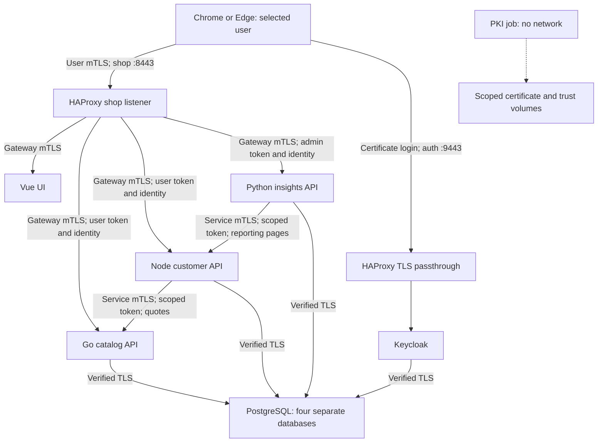
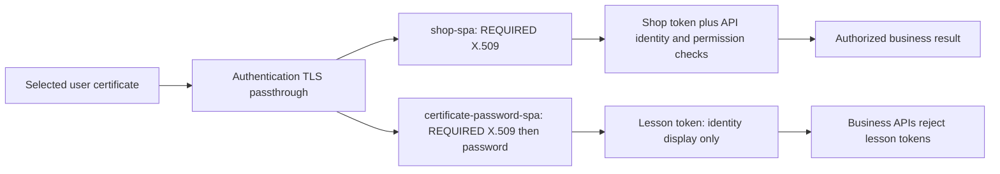
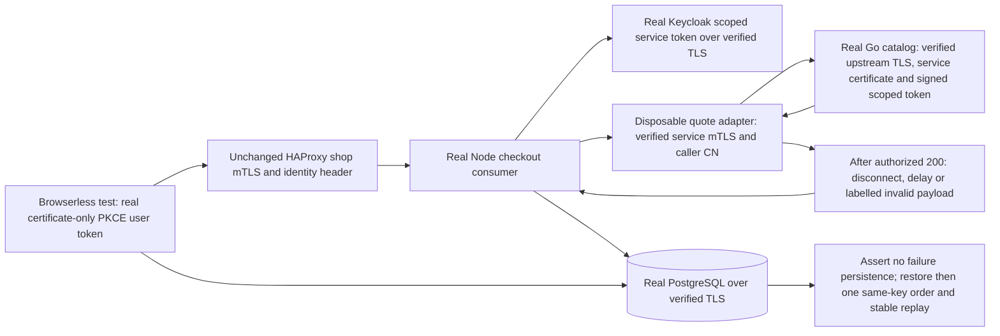
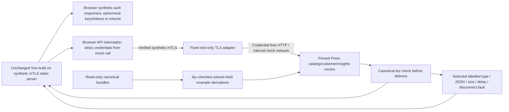
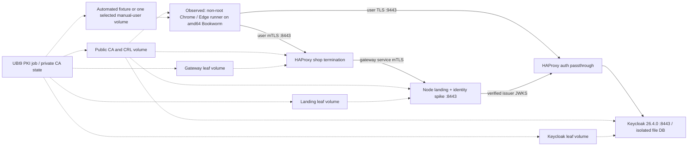
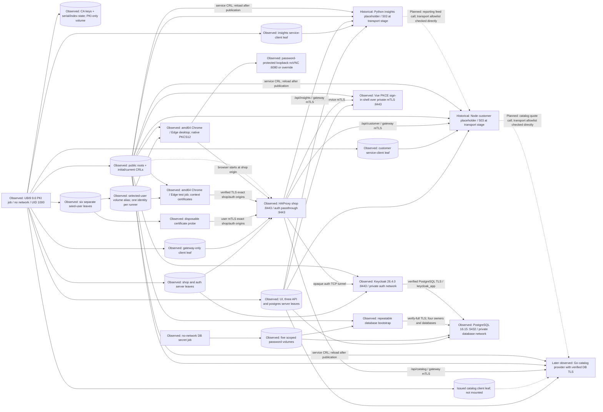

# Architecture and implementation decisions

This document describes the implemented teaching lab and its test boundaries.
Use the [project terminology dictionary](project-terminology.md) and [writing guide](writing-guide.md) with this document.
The [plain-language introduction](plain-language/project.md) gives a shorter system overview.

## Current state and evidence

The lab runs Vue, Keycloak, HAProxy, PostgreSQL, and three business APIs.
The APIs use Go, Node, and Python.
Vue uses Keycloak Authorization Code with PKCE and keeps tokens in memory.
The shop requires certificate-only login.
A separate lesson requires both a certificate and password.

The test workspace shares Saturday page, element, and login models between Playwright Test and Cucumber.
It uses actual Chrome and Edge.
Local Apple Silicon runs use amd64 emulation for the browser runner.
A human confirmed the customer Chrome and administrator Edge manual sessions there.

Native Linux push run `38115515064` and PR run `38115518115` passed all 13 expanded CI jobs.
These results include live contracts/security/browser tests and the separate certificate-password lesson.
Mock-consumer, dependency-fault, and regional jobs retain separate evidence.
[Completion 26](completion/26-independent-ci-evidence.md) records exact runs, environments, commands, and limits.
This document revision does not claim a new runtime test.

Earlier runs failed report upload or crashed in the automated browser certificate proxy's Node HTTP/2 path.
The Keycloak-side HTTP/2 change did not fix the crash and was removed.
Later runs passed with automated Chrome and Edge using `--disable-http2`.
This observation does not establish the exact cause of the race.
TLS verification and certificate selection remain active.
See [native CI history](completion/12-native-linux-ci.md) for the original failures and continuation.

Native Linux manual viewer and host operator checks remain unverified.
Standalone JWT and OIDC examples retain their recorded local evidence.
Literal clean-checkout/repeat-startup verification remains distinct from new-volume startup evidence.
The regional timestamp precision issue and affected 25-row UI limit remain open limitations.

## Topology

Solid arrows show request paths. The dotted arrow shows certificate provisioning.
The diagram omits individual trust mounts and token/JWKS requests.
The authentication listener passes browser TLS to Keycloak without terminating it at HAProxy.
See [authentication](authentication.md) and [expanded workflows](workflows.md) for those details.

## Containers and tool choices

| Service or job | Responsibility | Pinned tool family |
| --- | --- | --- |
| `ui` | Vue shop, account, inventory, reporting, and separate lesson | Node 24.10 Bookworm; keycloak-js 26.2.4 |
| `keycloak` | User mapping, clients, roles, flows, and token issuance | Keycloak 26.4.0 |
| `catalog-api` | Catalog, inventory, and private quotes | Go 1.25.3 builder; UBI9 runtime; pgx 5.11.0; golang-jwt 5.3.1 |
| `customer-api` | Profiles, orders, checkout, widgets, and private reporting feed | Node 24.10 Bookworm; pg 8.23.1; jose 6.2.12 |
| `insights-api` | Regional reports and local follow-up notes | UBI9 Python 3.12; PyJWT 2.15.1; psycopg 3.2.13 |
| `gateway` | Shop certificate checks, backend mTLS, and authentication passthrough | HAProxy 3.2.6 |
| `postgres` | Four database owners with separate credentials and persistent records | PostgreSQL 16.15 Trixie |
| `pki` | Certificate issuance, renewal, revocation, and CRLs | UBI9 9.6 with OpenSSL |
| `auth-secrets` / `realm-bootstrap` | Scoped secrets and idempotent realm setup | UBI9 9.6 / Node 24.10 |
| Test and manual runners | Actual Chrome and Edge; shared test models; optional desktop | Node 24.19 Bookworm amd64; pinned browser packages; FFmpeg 1011 |

The [compatibility record](compatibility.md) and [dependency strategy](dependency-strategy.md) explain version choices and base-image exceptions.
Completion notes record actual image IDs and runtime versions for each observed run.
Do not infer a run's environment from a tool-family label alone.

The default profile has seven long-running services.
PKI, secret generation, and database bootstrap are completed jobs.
Optional test and manual profiles add their selected runner.
The host needs Docker Compose and a shell. It needs no language runtime or certificate installation.

Browserless `runner-contracts` and `runner-security` have scoped identities and public trust.
They have no CA signing-key mounts.
Revocation and validity runners receive only the leaves and secrets needed for their selected checks.
Scope and signing-key rotation fixtures use separate privileged jobs in disposable realms.
The browser runner does not receive the privileged bootstrap secret.
See [Compose configuration](../infra/compose.yaml) and [coverage evidence](teaching-coverage.md) for the named profiles.

## Network and origins

| Entry or route | Destination |
| --- | --- |
| `https://shop.magic.test:8443` | HAProxy shop TLS listener |
| `https://auth.magic.test:9443` | HAProxy authentication TCP listener |
| `https://auth.magic.test:9443/realms/magic-shop` | Canonical token issuer |
| `/api/catalog/*` | Go catalog API |
| `/api/customer/*` | Node customer API |
| `/api/insights/*` | Python insights API |
| Other shop paths | Vue UI |
| Unknown paths in the API namespace | API 404, not the UI shell |

Discovery, token requests, and JWKS use the canonical issuer origin.
Changing it to `localhost` or a container name changes issuer and server identity checks.
HAProxy backend DNS refresh supports recreated containers while preserving TLS server-name checks.
Keycloak passthrough does not depend on trusted HTTP forwarding headers.

Business API, Keycloak, and database ports are internal.
The lab separates `front`, `backend`, `auth`, and `database` networks.
Private API origins are `https://catalog-api:8443`, `https://customer-api:8443`, and `https://insights-api:8443`.
Private business operations have no browser-facing HAProxy route.
Container health endpoints are not routed publicly.
Only the optional protected manual viewer publishes on `127.0.0.1`, at port 6080 by default.
No host DNS or trust-store change is required.

## Domain and service ownership

| Owner | Records | Public operations | Private capability |
| --- | --- | --- | --- |
| Go catalog | Items, categories, and display stock | Browse, detail, create, update, and archive items | Price quotes for the customer service |
| Node customer | Profiles, orders, immutable order lines, and widget layouts | Own account/orders/widgets; checkout; authorized administrator lists | Revisioned reporting pages for insights |
| Python insights | Region definitions and follow-up notes | Administrator reports, map data, and local notes | Reads the customer reporting feed |
| Keycloak | Users, protected identity mappings, roles, and clients | Configured OIDC flows | Trusted operator setup |

The [canonical OpenAPI 3.1 contracts](../contracts/openapi/README.md) define the exact interfaces.
Go implements six business operations, Node ten, and Python seven.
Each provider packages and exposes its authenticated bundled contract.
Live browserless tests check the 23-operation status coverage gate.
[Completion 25](completion/25-pr-base-contract-evidence.md) records actual unchanged, additive, and breaking PR-base comparisons.

The [domain ownership table](domain-contract-design.md#domain-dictionary-and-ownership) defines business invariants.
The terminology dictionary explains preferred writing terms. Neither document is a second canonical API specification.

### Checkout and historical records

Checkout accepts item IDs and integer quantities.
Node requests current prices from Go, computes totals, and saves name/price snapshots.
It applies the owner-scoped `Idempotency-Key` with the order transaction.
It does not trust totals supplied by the browser.
Stock is informational. Atomic stock reservation and real payments are outside this prototype.

Money uses integer copper. Dates use UTC timestamps and half-open `[from, to)` filters.
GeoJSON coordinates use longitude/latitude order. Leaflet coordinates need the corresponding conversion.
IDs are stable synthetic identifiers, not permission grants.
Lists use bounded pagination. The affected regional UI currently displays only the first 25 rows.

An order retains its historical region.
A profile change does not rewrite earlier orders.
Sales summaries count completed orders and distinct customers in the selected historical region and interval.
They do not count all customers currently living in that region.

Python reads Node's bounded, revisioned reporting feed. It cannot query Node's database directly.
The consumer rejects overlarge or unstable feeds instead of returning partial totals.
The mixed whole/fractional-second timestamp comparison remains a known limitation.
See [regional completion](completion/24-regional-reporting-boundaries.md) for the exact observed case.

## User experience

The UI retains the imported shop theme, images, cart, item details, account, and locations view.
Certificate-backed Keycloak login replaces the old mock login.
It shows the current identity and role, logout, and access-denied states.

Customers see their own orders and permitted widgets.
Shopkeepers can maintain catalog items.
Shop-admin users see customer/order lists, sales, region filters, and the linked map.
Widget layouts persist. API checks reject unsupported widgets and another user's layout.
The regional map and table share filters and have equivalent keyboard-accessible table controls.
They show loading, empty, and error states.

The map uses deterministic local assets and GeoJSON.
CI does not depend on external map tiles.
Asset notices preserve the imported attribution.
Follow-up notes are local synthetic records. They send no email, SMS, or other external message.

## Data, isolation, and reproducibility

Keycloak, catalog, customer, and insights have separate PostgreSQL databases and credentials.
Services cannot query each other's stores.
Database connections use verified TLS with password authentication.
Database client-certificate authentication is outside the current business-service mTLS evidence.

The [seed and independent reporting oracle](../seed/README.md) define six identities, four regions, and nine baseline orders.
The bootstrap loads synthetic fixtures idempotently.
Additional boundary suites use their own deterministic records in disposable projects.
Legacy passwords, access tokens, and mock authentication are not imported into the real lab.

Parallel workers use separate test IDs and fresh browser contexts.
Destructive certificate and realm tests use disposable projects or dedicated identities.
An explicit reset removes only the named project's resources.
Ordinary startup retains orders, notes, certificates, and users.
Run metadata records source revisions, image digests, and observed tool versions.

## Operator privilege boundary

The Go operator uses Bubble Tea, Bubbles, and Lip Gloss.
It is built in a pinned container and runs as a trusted host process.
It calls Docker Compose and the existing `lab` commands.
No API or test runner receives a Docker socket.

Its healthcheck requires all seven core services to be healthy.
It checks the optional manual viewer when present.
A completed test runner is judged by its exit status, not by a running state.
The operator shows bounded redacted telemetry and public certificate metadata.
Apple Silicon operator checks are recorded in [completion 13](completion/13-operator-tui.md).
Native Linux operator checks remain unverified.

## Certificate + password teaching boundary

The `shop-spa` client retains its REQUIRED X.509 flow and exact callback.
The separate `certificate-password-spa` client requires X.509 followed by the password form.
Its adapter owns only the lesson path and exact callback.
Both clients use Authorization Code with PKCE S256.
Keycloak owns password collection and verification.
The lesson displays verified token identity. Business APIs reject lesson tokens.
Operator password setup uses hidden container input. Bootstrap preserves existing passwords.

The branches represent separate client flows, not alternative checks within a single login.
See [authentication](authentication.md#separate-certificate--password-teaching-view) for exact client and callback rules.

## TEST-03 disposable checkout fault boundary

The [checkout fault overlay](../testing/faults/checkout/README.md) uses the unchanged real stack in a fresh private project.
Only Node's test-container host mapping redirects private catalog quotes to the adapter.
Public catalog routing, Vue, Keycloak, PKCE, certificate pairing, and API verification remain unchanged.

The adapter has only that project's catalog server leaf and Node caller leaf.
It verifies the service CA, CRL, and caller CN.
It forwards the original service token to Go with verified upstream TLS and mTLS.
Go authorization precedes the injected reply.
This is a trusted disposable component, not certificate passthrough or a production proxy.

The five fault cases require no failed-checkout persistence and successful same-key recovery and replay.
Their independent evidence gate stays separate from normal live-provider coverage.
[Completion 19](completion/19-checkout-dependency-faults.md) records local evidence.
[Completion 26](completion/26-independent-ci-evidence.md) records the subsequent native job and cleanup control.
Reports do not retain access tokens, private keys, profiles, or raw failure attachments.

## TEST-08 checkout concurrency and response loss

The [idempotency overlay](../infra/checkout-idempotency.compose.yaml) adds a private response-loss intermediary and database observer.
Normal races use HAProxy, Node, and Go without route changes.
A scoped database connection holds a SHARE table lock.
The test requires `pg_locks` and `pg_stat_activity` to show each Node INSERT waiting before release.
The owner/key unique constraint selects one persisted winner.

Only the lost-response case redirects the test client socket to the intermediary.
The exact shop URL, SNI, and verified TLS remain.
The intermediary checks the selected customer certificate.
It forwards the unchanged token with the same disposable certificate to real HAProxy.
It stores the committed canonical response in a private volume and disconnects before headers.
Direct gateway replay must match that response and leave database state unchanged.
These are two verified TLS connections, not certificate passthrough.

The four cases check actual waiters, database counts/revisions/hash, stable 201 replay, 409 conflict, and trust/auth rejection.
[Completion 20](completion/20-checkout-idempotency.md) records local evidence.
The separate native job is recorded in completion 26.

## TEST-05/07 isolated Prism consumer architecture

The [Prism project](../testing/prism/compose.yaml) has no connection to real Keycloak, HAProxy, or business APIs.
Only disposable derivatives remove security metadata. Canonical schemas, paths, and headers remain unchanged.
The unchanged Vue build receives synthetic authentication through browser interception.
Business replies come from pinned Prism through a verified synthetic-mTLS adapter.
Credentials do not reach the private HTTP mock hop.
Valid replies are checked against the canonical contract before deliberate faults are applied.

The compatibility experiment uses a synthetic upstream to check supported behavior and constraints.
Prism does not forward the selected client certificate in this experiment.
It is not used on real authenticated routes.
[Completion 21](completion/21-prism-compatibility.md) records compatibility limits.
[Completion 22](completion/22-prism-browser-failures.md) records local journeys and videos.
Completion 26 records the separate native consumer job.
These reports cannot prove real login or normal provider behavior.

## TEST-06/09 isolated reporting sequence boundary

The disposable overlay redirects only insights-to-customer reporting DNS to a verified mTLS wrapper.
Python and Keycloak remain unchanged.
The wrapper checks the insights certificate identity.
Real Node validates the reporting token on the same private operation.
The wrapper then makes a credential-free request to Mokapi on a separate internal network.

Mokapi supplies scripted pages. Node provides real authorization checks.
Those checks do not prove that mock cursors or datasets are real Node records.
Normal routing and application authorization remain unchanged.
[Completion 23](completion/23-mokapi-reporting-sequences.md) records local behavior and limits.
Completion 26 records the separate native reporting job.

## Independent CI evidence boundary

CI requires the existing live-provider/security/browser job and the separate real certificate-password job.
Consumer, checkout, reporting, idempotency, and regional selections produce their own reports.
The final gate rejects missing, skipped, cancelled, or failed required jobs.
Mock and fault reports do not contribute to normal live-provider coverage.

Only allowlisted, scanned, readable text reports leave the runner in native uploads.
Applicable browser jobs require local video evidence but do not upload those videos.
Separate intentional-failure probes and always-running cleanup check disposal.
See [the CI guide](../testing/ci/README.md) and completion 26 for commands and actual outcomes.

## Architecture checks

| Decision | Check and evidence scope |
| --- | --- |
| Exactly three business APIs in three languages | Compose inventory, static builds, and runtime checks |
| Container-only certificate lifecycle | Mount/wrapper checks; local macOS trust audit; native jobs without host certificate installation |
| Certificate gate and token permissions | Handshake, token, role, ownership, and identity-mismatch negatives |
| Separate service data ownership | Dependency and database grant checks |
| Canonical OpenAPI interfaces | Lint, generated/spec drift, PR-base comparison, and live contracts |
| Shared Saturday models | Equivalent journeys through both runner adapters |
| Deterministic regional UI | Offline map and seeded aggregate/table assertions within recorded limits |
| Actual Chrome and Edge | Installed binary versions and channel checks; no bundled Chromium substitution |
| UBI9 preference with exceptions | Pinned image records and compatibility observations |
| Independent evidence gates | Missing/failed-result mutation tests and observed native intentional-failure run |

The [host trust audit](completion/12-host-trust-audit.md) observed unchanged macOS trust and keychain fingerprints.
That audit is not a Linux trust-store before/after measurement.
Test counts and per-ID scope remain in the coverage map and completion notes.
Service boundaries and the fantasy presentation are judgment-only choices for a manageable teaching example.
Automated checks enforce their implementation, but do not prove that this is the only suitable decomposition.

## Historical feasibility and transport stages

The diagrams below retain earlier stage snapshots. They do not describe missing features in the current system.

### Prompt 01 spike

The bounded `spikes/certificate-login` harness used a Node landing/identity endpoint instead of business APIs.
It used Keycloak file storage rather than the current PostgreSQL setup.
Actual Chrome and Edge ran on amd64 Bookworm under Apple Silicon emulation.
UBI9 remained the PKI base after its verified repositories lacked required desktop packages.
The spike trusted only the user CA for certificate authentication.
See [completion 01](completion/01-certificate-login-feasibility.md) for the original acceptance scope.

Solid arrows show requests. Dotted arrows show scoped certificate or public trust mounts.
The landing endpoint is a spike component, not a current business API.

### Prompt 03 infrastructure overlay

The early infrastructure stage established networks, certificate volumes, database isolation, and private API listeners.
Node and Python still returned 503 for unimplemented business operations at that stage.
Go's implementation was added during the recorded continuation.
The current APIs subsequently implemented the business operations shown above.
See [completion 03](completion/03-container-infrastructure.md) for transport checks and original timing.

Solid arrows show requests or established mounts. Dotted arrows retain that stage's planned mounts and service calls.
Historical 503 placeholders are not current provider behavior.
The stage verified fresh-connection user and service revocation, exact origins, server names, and database isolation.
It also checked the native certificate store for customer Chrome and administrator Edge on Apple Silicon.
Later implementation and native results are linked in the current evidence sections.
