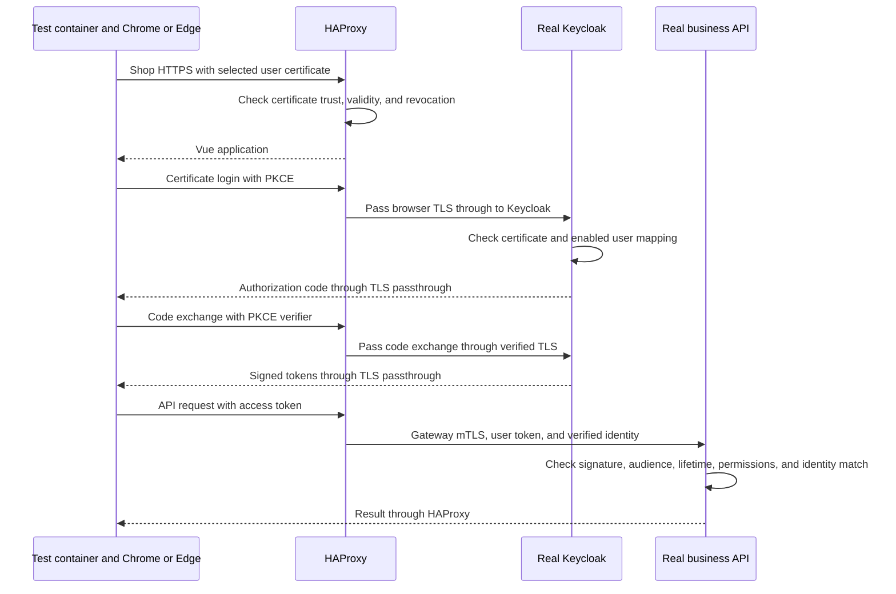
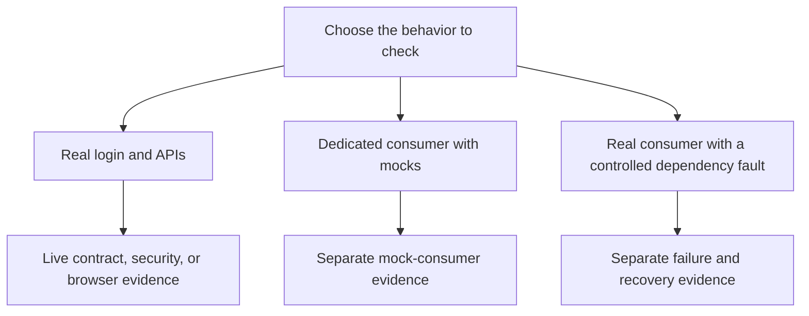

# Get started with certificate tests

Run a real certificate-login browser test with Docker and the existing `lab` wrapper.
You don't need to install Node, Go, Python, OpenSSL, or lab certificates on your computer.

The Magic Shop is a local teaching application with Vue, Keycloak, and three business APIs.
Builds, certificate operations, and tests run in containers.
Private keys, secrets, and browser profiles stay in Docker volumes.

For a short explanation you can share, see the [project pitch and current gaps](project-pitch.md).

## Before you begin

You need:

- A checkout of this repository.
- Docker with Docker Compose available and the Docker engine running.
- A terminal with a POSIX-compatible shell.
- Network access for the initial image and dependency downloads.

The automated browser setup has recorded results on Apple Silicon with amd64 emulation and native Linux amd64 CI.
Other environments aren't established by those results.
The first build downloads several images and real Chrome and Edge packages, so allow time for it to finish.
Exact browser packages can disappear from their upstream repositories; see [compatibility](compatibility.md) if a pinned download fails.

## Start the lab

1. In your terminal, open the repository directory:

   ```sh
   cd /Users/oscarrieken/Projects/Rieken/testing-with-certs
   ```

   If you cloned the project elsewhere, use your checkout path instead.

2. Choose a project name for your Docker resources:

   ```sh
   export LAB_PROJECT=magic-shop-getting-started
   ```

   Keep this setting for the remaining commands in the same terminal.
   If you open another terminal, set the same value there.
   Use a different lowercase project name if you need a separate lab.

3. Build and start the lab:

   ```sh
   ./lab up
   ```

   The wrapper creates certificate volumes, initializes databases, starts services, and provisions Keycloak users and clients.
   Repeating this command preserves existing certificates and records.
   If startup fails, use the troubleshooting table below before you run a test.

4. Check the service state:

   ```sh
   ./lab status
   ```

   The seven core services should be running. Completed setup jobs aren't long-running services.
   Test runner images are built when you first run their tests.

## Run your first browser test

Run the customer journey in real Chrome:

```sh
./lab test --runner playwright --browser chrome --user customer-waterdeep
```

The wrapper starts a test container with the selected customer's certificate.
Playwright opens Chrome, follows real Keycloak login, and checks the customer journey.
Server TLS verification stays enabled.
A successful command exits with status 0 and writes a local report under `artifacts/teaching/`.
The terminal prints the exact report directory.

This command checks a selected browser journey. It doesn't run the complete test matrix.
To use Edge, replace `chrome` with `msedge`.
To use the Cucumber customer example, replace `playwright` with `cucumber`.

## Run contracts and security checks

Run the browserless suites before the full browser matrix:

```sh
./lab test --runner playwright --suite contracts &&
./lab test --runner playwright --suite security
```

The contract suite checks the real Go, Node, and Python APIs against their canonical OpenAPI contracts.
Its gate requires coverage of all 23 business operations and required status cases.
The security suite checks selected TLS, token, role, ownership, and identity boundaries.
The second command runs only if the first succeeds.

## Run the core browser matrix

For one command that builds the workspace, infrastructure, and all three services, then runs the real-system suites, use:

```sh
sh testing/run-all.sh all
```

If pnpm is already available in your host terminal, the equivalent root package script is:

```sh
pnpm run build:test
```

The package scripts call the Docker wrapper. Builds, dependency installs, and test execution still happen in containers.
`pnpm run build:all` runs container builds and unit/static checks only.
`pnpm run test:all` also builds the required images, then runs the real-system checks.
The `test` and `all` modes have the same complete verification behavior.

The complete run creates its own `magic-shop-all-*` project and ignores a retained `LAB_PROJECT` setting.
It runs PKI/database checks, packed-package checks, live contracts/security, eight customer/admin browser selections,
two shopkeeper browser selections, and the 36-case certificate-password lesson.
It stops on failure and removes only that disposable project's containers, networks, and volumes.
It retains local reports under `artifacts/`.
See [all-service verification](completion/27-all-service-command.md) for observed results, environment, and exact commands.
The separate mocks, fault suites, and regional expansion suites remain separate commands in their guides.
If your terminal is forcibly killed or Docker becomes unavailable, the exit trap can't guarantee cleanup.
Use the printed project name with the scoped recovery command:

```sh
LAB_PROJECT=magic-shop-all-REPLACE-WITH-PRINTED-ID sh testing/cleanup-certificate-password.sh
```

Run these commands from the repository root after successful startup:

```sh
(
  set -e
  ./lab test --runner playwright --suite contracts
  ./lab test --runner playwright --suite security

  for runner in playwright cucumber; do
    for browser in chrome msedge; do
      for user in customer-waterdeep shop-admin; do
        ./lab test --runner "$runner" --browser "$browser" --user "$user"
      done
    done
  done
)
```

This sequence stops at the first failed command.
It checks both runners, both browsers, and both customer and administrator identities: eight browser selections.
It doesn't include the separate certificate-password lesson, mock suites, or dependency-fault suites.
For the additional Playwright shopkeeper journey, run:

```sh
./lab test --runner playwright --browser chrome --user shopkeeper
```

## How certificate testing works



The browser's certificate proves its selected identity at the TLS and login boundaries.
The access token supplies claims that each API validates before it allows an action.
The API also checks that the token identity matches the gateway's verified user certificate identity.
Mutual TLS (mTLS) checks the client certificate on gateway-to-API connections.
The diagram shortens response paths; login and token exchange use the authentication passthrough route.

The normal shop is certificate-only. It has no password fallback.
The separate teaching lesson requires both the certificate and the account password.
Its tokens don't grant business API access.
See [authentication details](authentication.md) for the exact clients, origins, and service-token checks.

## Choose additional test examples

| You want to check | Start here | What the result doesn't prove |
| --- | --- | --- |
| Both certificate and password checks | [Certificate-password lesson](../testing/README.md#certificate--password-lesson) | A manual demonstration or video of every matrix case |
| A standalone JWT, OIDC, or API consumer with replaced dependencies | [Mock consumer examples](../spikes/mock-auth/README.md) | Real Keycloak login or production API authorization |
| Browser behavior with synthetic authentication and Prism responses | [Prism browser tests](../testing/prism/README.md) | Real login or real-provider correctness |
| Real checkout behavior when quotes fail | [Checkout faults](../testing/faults/checkout/README.md) | Normal live-provider coverage for every operation |
| Checkout races and a lost response | [Idempotency tests](../testing/faults/idempotency/README.md) | Stock reservation or payment processing |
| Reporting page failures and recovery | [Mokapi reporting tests](../testing/faults/reporting/README.md) | That scripted mock pages are real customer API records |
| Historical regions, dates, totals, and map behavior | [Regional boundary tests](../testing/regional/README.md) | Support for the recorded timestamp precision limitation |

These suites use their own documented setup and disposable projects.
Mock authentication never reaches real business APIs.
Mock and fault reports don't replace the required normal live-provider reports.



The branches are different test setups. There is no mock-authentication path into the real APIs.

## Review reports and videos

The browser wrapper prints its local report directory under `artifacts/teaching/<run-id>/`.
Playwright Test writes HTML, JUnit, and per-test WebM recordings.
Cucumber writes JSON, JUnit, and scenario telemetry.
Other suites document their own artifact locations and recording options.

Use assertions and recordings together. A video shows visible actions, not every hidden API or database check.
Review local videos before sharing them; they can show the login flow.
Native CI uploads scanned, allowlisted text reports, not videos, profiles, secrets, or network captures.
See [test evidence and current gaps](project-pitch.md#current-gaps) before you treat a result as broader support.

## Stop or remove your lab

To stop the selected project while preserving its data, run:

```sh
./lab down
```

When you no longer need the example project's records or certificates, remove that named project:

```sh
./lab reset --project magic-shop-getting-started
```

Reset deletes that project's containers and volumes, including its certificate authority and databases.
If you chose another project name, use that exact name in the reset command.
The isolated suites have their own cleanup procedures; use those procedures for their projects.

## Troubleshoot your first run

| Symptom | Next step |
| --- | --- |
| Docker isn't available | Start Docker, then check `docker version` and `docker compose version`. |
| A pinned image, browser, or dependency can't download | Check the error and [compatibility record](compatibility.md). Don't replace a pin with an unreviewed floating version. |
| Startup doesn't reach healthy services | Run `./lab status` and review the failing service's setup output. |
| A certificate or hostname check fails | Run `./lab pki verify`. Keep the exact lab origins and TLS verification enabled. |
| The wrong user appears | Check `--user` and `LAB_PROJECT`. Recreate manual mode when switching human viewer identities. |
| A test fails after the connection succeeds | Review the named test report. A working TLS connection doesn't prove authorization or business correctness. |
| You can't open the shop directly in your host browser | Use the [manual container browser](manual-browser.md). Only its protected viewer is forwarded to host loopback. |

For more troubleshooting and lifecycle exercises, see the [teaching guide](teaching-guide.md).

## Documentation approach

This guide follows Google's recommendations for direct address, active voice, sentence-case headings, and ordered procedures.
See the [Google style highlights](https://developers.google.com/style/highlights),
[procedure guidance](https://developers.google.com/style/procedures), and
[voice and tone guidance](https://developers.google.com/style/tone).
The shared [project terminology dictionary](project-terminology.md) keeps technical meanings consistent.
