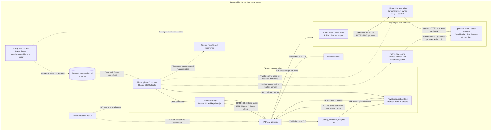
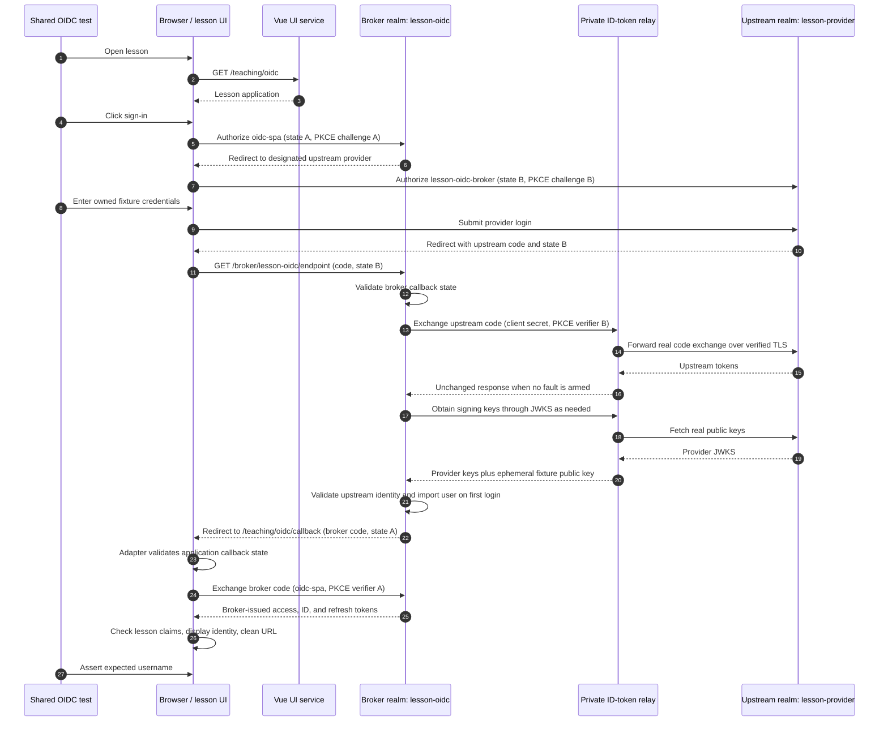
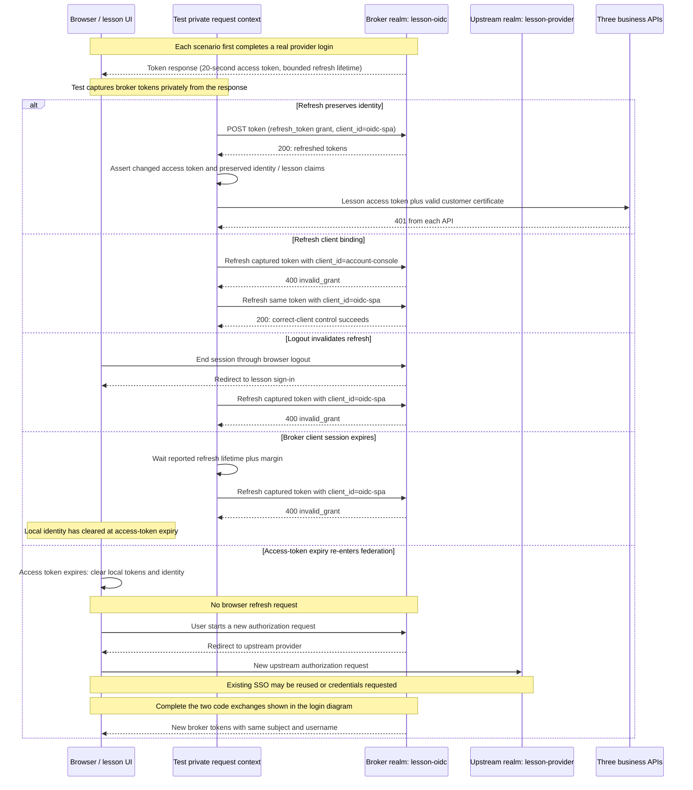

# How OIDC testing works

The OpenID Connect (OIDC) suite tests a real login from the lesson UI, through a Keycloak broker, to a controlled identity provider. It also tests callback rejection, token boundaries, logout, expiry, and refresh.

Both the provider and broker use Keycloak. They run in separate realms on the same `lesson-provider` container. This separation gives the tests a real federation boundary without an external account or cloud tenant.

This guide describes the controlled `/teaching/oidc` lesson. The [authentik lessons](certificate-free-lessons.md) and [mock OIDC consumers](../spikes/mock-auth/README.md) are separate suites. The main shop also uses OIDC, but authenticates users with certificates; see [authentication](authentication.md).

To apply these patterns to another project, use the reusable [OIDC testing skill](../skills/oidc-testing/SKILL.md). It supports assessment, implementation, and container execution, with [starter prompts](../skills/oidc-testing/references/starter-prompts.md) for each mode. Install a copy of `skills/oidc-testing` in your Codex skills directory to invoke it as `$oidc-testing`.

## The moving parts



Solid arrows show requests or test actions. Dashed arrows show setup, mounted data, and evidence output. The two realms share a container but keep separate clients, users, sessions, and token issuers. The UI runs in the browser after the UI service delivers it.

| Part | What it supplies | Main source |
| --- | --- | --- |
| Docker Compose | Isolated services, networks, secrets, and persistent volumes for one disposable run | [Base stack](../infra/compose.yaml), [lesson overlay](../infra/auth-lessons.compose.yaml) |
| PKI and trust | Server certificates, the trusted lab CA, and the customer certificate used by API rejection checks | [Infrastructure guide](../infra/README.md) |
| HAProxy gateway | Routes the lesson UI, provider traffic, and protected business API traffic | [Gateway configuration](../infra/haproxy/haproxy.cfg) |
| Vue lesson UI | Starts login, handles the callback, displays identity, and clears identity at expiry | [Lesson configuration](../apps/magic-shop/src/teaching/certificate-free/lessons.ts), [session handling](../apps/magic-shop/src/teaching/certificate-free/session.ts) |
| `lesson-provider` service | Runs the upstream provider realm and the separate broker realms | [Provider startup](../infra/auth-lessons/provider.sh) |
| `lesson-provider` realm | Owns provider accounts and checks their passwords | [Federation setup](../infra/keycloak/federation.mjs) |
| `lesson-oidc` realm | Brokers upstream login and issues the lesson's application tokens | [Federation setup](../infra/keycloak/federation.mjs) |
| `oidc-spa` client | Public browser client in the broker realm, with exact callback and logout URLs | [Lesson definitions](../infra/keycloak/lessons.json) |
| `lesson-oidc-broker` client | Confidential client in the upstream realm; the broker uses its secret during federation | [Federation setup](../infra/keycloak/federation.mjs) |
| ID-token relay | Forwards real upstream exchanges and supports isolated signed-token validation probes | [Relay](../infra/oidc-token-fixture/server.mjs), [mutation/signature checks](../infra/oidc-token-fixture/tokens.mjs) |
| Native key control | Rotates only owned provider keys, restores originals and verifies no owned key remains | [Keycloak controller](../infra/oidc-token-fixture/key-control.mjs), [authentik control](../infra/authentik/oidc_keys.py) |
| Fixture service | Creates disposable users, applies short lifecycle policy, then restores and verifies cleanup | [Fixture implementation](../infra/keycloak/auth-lesson-fixture.mjs) |
| Browser runner | Runs real Chrome or Edge with trusted TLS and mounted fixture data | [Lesson overlay](../infra/auth-lessons.compose.yaml) |
| Shared test model | Implements all forty-seven OIDC behaviors for both runners | [OIDC checks](../testing/teaching/oidc.mjs), [callback/code boundaries](../testing/teaching/oidc-boundaries.mjs) |
| Reporting and recording | Writes filtered results and videos with provider documents hidden | [Reporter](../testing/reporting/auth-lessons.mjs), [recording wrapper](../testing/teaching/auth-recording.mjs) |

The ordinary startup also brings up shared dependencies for other lessons, including Kerberos. OIDC does not use Kerberos tickets, but the supported runner operates the combined authentication stack.

## Addresses and trust

These addresses resolve inside the lab networks. A host browser needs the separate [manual browser procedure](certificate-free-lessons.md#certificate-free-manual-viewer), rather than assuming the names resolve on the host.

| Address | Purpose | Client certificate required? |
| --- | --- | --- |
| `https://shop.magic.test:8543/teaching/oidc` | Certificate-free lesson UI | No |
| `https://shop.magic.test:8543/teaching/oidc/callback` | Browser application's OIDC callback | No |
| `https://shop.magic.test:9643/realms/lesson-oidc` | Broker issuer | No |
| `https://shop.magic.test:9643/realms/lesson-provider` | Upstream issuer | No |
| `https://shop.magic.test:9843/keycloak/token`, `/keycloak/jwks`, `/control` | Private relay exchange, key loading and authenticated control | No; control requires its private credential |
| `https://shop.magic.test:9853/keycloak` | Native key control for the disposable Keycloak provider realm | No; private fixture credential required |
| `https://shop.magic.test:8443/api/...` | Main shop's protected business APIs | Yes |

Port `9643` passes TLS traffic through HAProxy to `lesson-provider`. Port `8543` terminates TLS at HAProxy and serves only allowlisted lesson pages and assets. It does not expose the business APIs.

The browser and Node processes trust the generated lab CA. Tests keep TLS verification enabled. Gateway connections to the UI and business APIs also verify certificates and use mutual TLS.

The lesson login needs no user certificate. The API rejection checks deliberately provide a valid customer certificate, so a missing certificate cannot explain the rejection.

## A successful login, in request order



The diagram omits HAProxy hops: UI requests use port `8543`, both realm URLs use port `9643`, and the private relay uses port `9843`. State A/B and PKCE A/B label the two independent authorization exchanges; they are explanatory names, not fixture values. Signing keys may already be cached.

1. The runner creates a fresh browser context and opens `/teaching/oidc`.
2. The test clicks **Sign in with OpenID Connect**.
3. `keycloak-js` starts authorization against `lesson-oidc` for client `oidc-spa`.
4. The broker's `oidc-browser` flow selects its designated upstream provider, alias `lesson-oidc`.
5. The browser reaches the upstream `lesson-provider` realm. The test enters that scenario's fixture credentials.
6. The provider returns an authorization code to `/realms/lesson-oidc/broker/lesson-oidc/endpoint`.
7. The broker exchanges the upstream code using confidential client `lesson-oidc-broker`. Its configuration requires PKCE S256 and signature validation. The private relay forwards token/JWKS requests to the provider; normal token responses remain unchanged and the disposable JWKS also advertises the ephemeral fixture public key.
8. On first login, the broker creates a local user if the identity is unique. The broker then returns a separate code to the application's `/teaching/oidc/callback`.
9. The browser adapter exchanges that code with the broker using public client `oidc-spa` and PKCE S256.
10. The UI checks the token's issuer, authorized client, lesson audience, subject, and username before displaying identity.
11. The callback handler removes callback parameters from the displayed URL.

There are two code exchanges and two callback addresses. The upstream callback belongs to the broker. The application callback belongs to the Vue lesson.

The browser receives a **broker-issued** access token. Its issuer is `https://shop.magic.test:9643/realms/lesson-oidc`, its `azp` is `oidc-spa`, and its audience includes `oidc-lesson`.

The browser adapter handles the application's callback state. Keycloak handles the broker callback state. Separate negative cases exercise both boundaries.

## What the tests check

The [case inventory](../testing/teaching/auth-matrix.mjs) defines forty-two baseline cases and five lifecycle cases. Each runs in Chrome and Edge through both Playwright and Cucumber: **188 required OIDC executions for forty-seven behaviors**. Required inventory is separate from the historical acceptance linked below.

| Baseline case | Required result |
| --- | --- |
| `oidc:login-audience-and-logout` | Provider login displays the expected user; token claims match the lesson; business APIs reject the token; logout returns to sign-in. |
| `oidc:disabled-provider-user` | The provider shows its disabled-account error and the lesson has no identity. |
| `oidc:callback-state-rejection` | Change only state on a genuine application callback; require rejection without token exchange or identity, then successful login using the untouched callback. |
| `oidc:cross-protocol-provider-rejection` | Asking the OIDC broker for the SAML provider produces a Keycloak error. |
| `oidc:broker-state-rejection` | After an untouched successful login control, change only state on a fresh real upstream callback; require the broker's page-expired response without application token exchange or lesson identity. |
| `oidc:app-wrong-verifier`, `oidc:upstream-wrong-verifier` | A real authorization code with a different valid-shaped PKCE verifier fails with `400 invalid_grant`. |
| `oidc:app-missing-verifier`, `oidc:upstream-missing-verifier` | A real authorization code without its PKCE verifier fails with `400 invalid_grant`. |
| `oidc:app-replay`, `oidc:upstream-replay` | Repeating a successful code exchange fails with `400 invalid_grant`. |
| `oidc:app-redirect`, `oidc:upstream-redirect` | An unregistered callback is rejected before credential entry. |

The [boundary checks](../testing/teaching/oidc-boundaries.mjs) exercise both clients through real browser authorization. Each code-boundary case first completes a successful private exchange using its registered callback, correct verifier, and confidential secret where applicable. Verifier negatives then obtain a fresh real code and change only the verifier field. Replay reuses the already-consumed control code. Private codes, callback URLs, verifiers, client secrets, and token responses never enter reports.

The boundary harness intercepts the provider credential response before browser redirects. It follows a bounded chain of real redirects through the trusted lab origins and stops before delivering the selected callback. The application state case can reuse its untouched callback as a control. The pinned broker expires the tampered transaction, so its control completes before a fresh negative transaction.

| Lifecycle case | Required result |
| --- | --- |
| `oidc:access-expiry-reenters-federation` | Identity disappears at access-token expiry; a new upstream authorization request signs in the same subject and username. |
| `oidc:refresh-preserves-identity` | A private refresh request succeeds, changes the access token, and preserves subject, username, issuer, client, and lesson audience. |
| `oidc:logout-invalidates-refresh` | Browser logout makes the captured broker refresh token fail with `400 invalid_grant`; reload leaves the lesson signed out. |
| `oidc:refresh-client-binding` | Refresh under `account-console` fails with `400 invalid_grant`; the same token still succeeds under `oidc-spa`. |
| `oidc:session-expiry-rejects-refresh` | After the broker client session expires, refresh fails with `400 invalid_grant` and the lesson has no identity. |

The [token helper](../testing/teaching/auth-lessons.mjs) checks that lesson tokens exclude `catalog-api`, `customer-api`, and `insights-api` audiences. It sends each checked token to all three real APIs with a valid customer certificate and requires `401` responses. JWT decoding here inspects claims; decoding alone does not validate a signature. The real provider, broker, and API paths supply the server-side checks.

The lesson clears its local identity when the access token expires. It does **not** silently refresh. Refresh tests use the runner's private request context. The expiry test observes zero browser refresh requests and requires another real upstream authorization request.

Provider SSO cookies can survive this expiry. Re-entry can reuse SSO or show another credential form. The test handles the provider's password-only form; it does not require every re-entry to prompt for a password.

## Upstream ID-token validation

The [shared upstream checks](../testing/teaching/oidc-upstream.mjs) exercise the Keycloak broker's validation of ID tokens from both upstream providers. These requests happen on the server; browser routing cannot intercept them. The disposable [ID-token relay](../infra/oidc-token-fixture/server.mjs) therefore sits between the broker and the real upstream token/JWKS endpoints. Both providers continue to perform real authorization-code exchanges with PKCE and their confidential client credentials.

```mermaid
sequenceDiagram
  participant Browser as Browser / lesson
  participant Broker as Keycloak broker
  participant Relay as Private ID-token fixture
  participant Provider as Keycloak or authentik
  Browser->>Broker: Begin authorization
  Broker->>Provider: Browser authorization with nonce and PKCE
  Provider-->>Broker: Real authorization code through browser
  Broker->>Relay: Server-side code exchange over trusted HTTPS
  Relay->>Provider: Forward original request with TLS verification
  Provider-->>Relay: Real token response
  Relay->>Provider: Fetch real public JWKS
  Note over Relay: Verify original ID-token signature, issuer, audience, expiry and nonce presence
  Relay-->>Broker: Replace only ID token; retain other response fields
  Broker->>Relay: Load public JWKS over trusted HTTPS
  Relay-->>Broker: Real provider keys plus ephemeral fixture public key
  alt Signed valid control
    Broker-->>Browser: Application authorization code
    Browser->>Broker: Application token exchange
    Broker-->>Browser: Valid lesson tokens
  else One isolated ID-token fault
    Broker-->>Browser: Rejection at broker callback
    Note over Browser: No application code, exchange or lesson identity
  end
```

The fixture signs semantic negatives with an ephemeral RSA key advertised only to these disposable broker realms. Its private key remains in the relay process's memory; the runner receives only a private control credential. The valid signed control preserves all claims while using that same key. Each negative first passes this control, changes one field or signature/key input in a fresh transaction, requires the broker callback to return an error, and then succeeds through a new unmodified live exchange. Cookies are cleared between these independent transactions; this is separate from the cancellation/recovery suite's same-context preservation contract.

| Case suffix after `upstream-id-token-` | Required result |
| --- | --- |
| `signed-control` | A re-signed ID token with unchanged provider claims is accepted, proving the fixture key and relay configuration work. |
| `signature` | Corrupt only the RSA signature with the trusted key ID retained; reject. |
| `unknown-key` | Keep a valid RSA signature but use a key ID absent from JWKS; reject. |
| `issuer` | Replace only `iss` with an untrusted issuer; reject. |
| `audience` | Replace only `aud` with an unrelated upstream client; reject. |
| `authorized-party` | Replace only `azp`, keeping the correct audience; reject. |
| `expired` | Set only `exp` five minutes in the past; reject. |
| `not-yet-valid` | Set only `nbf` five minutes in the future; reject. |
| `nonce` | Change only the real ID-token nonce; reject. |
| `missing-nonce` | Remove only nonce from the real ID token; reject. |

Every rejection requires one verified upstream mutation, no application callback code, no browser broker-token request, and no lesson identity. Accepted controls and recovery sessions verify the expected user and lesson audience and require business-API denial. The pinned [Keycloak validation implementation](https://github.com/keycloak/keycloak/blob/26.4.0/services/src/main/java/org/keycloak/broker/oidc/OIDCIdentityProvider.java) checks signature/key selection, active time, audience, authorized party, configured issuer and transaction nonce; the tests exercise those server checks rather than using JWT decoding as a substitute.

The gateway exposes port `9843` only inside the lab and terminates TLS with the existing trusted shop certificate. The relay forwards to fixed HTTPS provider endpoints with verified trust; its private gateway/backend hop stays on the lab network. Control requests require a generated mode-0600 credential and exclusive owner lease. A second owner cannot arm, inspect or release a pending selection. The final harness check requires no armed mutation or retained transaction, including on failure, before the disposable service and credential volume are removed. No additional provider signing key is exported by this relay. Signature validation remains enabled, nonce validation is explicitly enabled and clock skew is zero in these owned broker fixtures.

This establishes rejection by the pinned Keycloak broker for both provider topologies. It does not establish direct authentik application-adapter validation, arbitrary cloud-provider interoperability, any provider-specific behavior beyond the cases described below, or a broker claim that was never mutated. Normal unarmed exchanges pass through unchanged. Test-key trust is confined to the disposable OIDC broker realms and is not added to business APIs or the main shop realm.

## Upstream logout and session revocation

[Four shared cases](../testing/teaching/oidc-sessions.mjs) separate browser SSO, OAuth grants and the broker's independent session. Every case owns a dedicated provider identity, real browser authorization, exact callbacks and S256 PKCE. No shared user is disabled, no invalidation policy changes and no fabricated logout response supplies these cases. Existing TLS verification and business-API authorization remain enabled.

| Case | Control, operation and required checks |
| --- | --- |
| `upstream-rp-logout` | Real upstream code exchange, successful refresh/UserInfo and silent SSO control; browser-initiated native end-session request with a valid ID-token hint, registered return and state; check old access-token UserInfo denial, refresh fate and silent SSO afterward; recover by fresh authorization and refresh. |
| `upstream-session-revoked` | Same working grant/SSO controls; native administration deletes only the dedicated user's provider sessions, observing a positive before count and zero afterward; check old UserInfo denial, refresh fate, silent SSO failure and fresh-authorization recovery. |
| `upstream-token-revoked` | Working grant/SSO controls; confidential client revokes the current real refresh token at RFC 7009 endpoint twice with HTTP 200; require `invalid_grant` without issued credentials; check the provider's remaining SSO behavior and recover. |
| `upstream-revocation-broker-boundary` | Real application login and successful broker refresh; prove upstream SSO; delete the dedicated upstream user's sessions; require upstream silent SSO failure while the unnotified broker session can still refresh with the correct lesson identity/audience/API denials; recover with a new real application login. |

The same browser context and cookies remain in place between the control, destructive action and silent SSO checks. A `prompt=none` request must return the expected state and either a code or `login_required`, without exchanging or exporting that probe's code. Cookie clearing happens only when deliberately starting a fresh recovery authorization. Browser pages must send no refresh grant; private request contexts perform refresh checks.

The pinned issuers have different contracts:

| Operation | Controlled Keycloak upstream | Pinned authentik upstream |
| --- | --- | --- |
| Native RP logout | Old access/refresh grant and browser SSO no longer work. | Old access grant no longer works; the refresh grant and authentik SSO remain available under the default provider invalidation flow. |
| Native administrative session deletion | Old access/refresh grant and browser SSO no longer work. | Old access grant and browser SSO no longer work; the independent refresh grant survives. |
| Refresh-token revocation | Refresh fails; this single-client fixture also loses upstream SSO when its last client session is removed. | Refresh fails; browser SSO remains available. |
| Upstream session deletion with an existing broker session | Broker refresh remains valid without configured upstream logout notification. | Same broker boundary; ending upstream SSO is not global broker revocation. |

These are configured, pinned-provider results to verify, not universal OIDC promises. Authentik's default invalidation flow omits a User Logout stage; its [native refresh-token model](https://github.com/goauthentik/authentik/blob/version/2026.8.4/authentik/providers/oauth2/models.py) explicitly keeps refresh tokens when their browser session is deleted. Its [session-deletion signal](https://github.com/goauthentik/authentik/blob/version/2026.8.4/authentik/providers/oauth2/signals.py) removes access grants. Keycloak's [revocation endpoint](https://github.com/keycloak/keycloak/blob/26.4.0/services/src/main/java/org/keycloak/protocol/oidc/endpoints/TokenRevocationEndpoint.java) removes the refresh token's client session and removes the user session if no clients remain.

```mermaid
sequenceDiagram
  participant Browser as Existing browser cookies
  participant Test as Private test requests
  participant Upstream as Real upstream provider
  participant Control as Fixed owned-user session control
  participant Broker as Independent Keycloak broker
  Browser->>Upstream: Real authorization; silent SSO succeeds
  Upstream-->>Test: Working access and refresh grants
  alt Native browser logout
    Browser->>Upstream: End session with valid hint and registered return
    Upstream-->>Browser: Observe real return state before broker callback
  else Administrative session deletion
    Test->>Control: Revoke only dedicated provider identity
    Control->>Upstream: Native session deletion and signals
    Control-->>Test: Before count positive; after count zero
  else RFC 7009 token revocation
    Test->>Upstream: Revoke current refresh token twice
    Upstream-->>Test: 200; subsequent refresh is rejected
  end
  Test->>Upstream: Check grant fate and silent SSO with retained cookies
  Note over Test,Upstream: Keycloak and authentik differ; assert their actual contracts
  Test->>Broker: Existing broker refresh after upstream session deletion
  Broker-->>Test: Remains valid when no logout notification is configured
  Browser->>Upstream: Fresh recovery authorization
```

[Keycloak session control](../infra/oidc-token-fixture/session-revocation.mjs) stays behind the existing private controller on internal HTTPS `9853`. It permits only two fixed test-account selectors in `lesson-provider`, refuses missing/ambiguous/unexpected accounts and requires a live session before revocation. [Authentik control](../infra/authentik/session_revocation.py) validates the dedicated identity against its private fixture inventory and uses native model deletion/signals. Neither exposes session IDs, credentials, arbitrary users or an administrative API to the runner. Both refuse a broker-boundary check if upstream logout-notification configuration has unexpectedly appeared.

Logout captures observe the real provider response and registered return before an unmatched broker transaction can consume it. Keycloak captures the initial logout response; authentik uses the existing flow-executor callback capture. A callback-only browser route is unreliable for later hops in a redirect chain and is not used as logout proof.

Session deletion is intentionally irreversible for these disposable identities. Recovery creates fresh sessions through real credentials instead of reconstructing deleted sessions. Normal fixture cleanup removes the owned accounts/imported users, and complete project teardown removes authentik's private database, grants and sessions. These checks do not add SLO configuration, claim backchannel delivery, revoke every application session globally, prove access-token revocation at offline JWT-verifying APIs, or establish race/cluster/cloud-provider behavior.

## Refresh-token rotation and reuse detection

[Four shared cases](../testing/teaching/oidc-refresh.mjs) distinguish the two refresh boundaries. `app-refresh-rotation` and `app-refresh-reuse` use the broker-issued application refresh token. `upstream-refresh-rotation` and `upstream-refresh-reuse` exercise the real upstream confidential client directly. Both still begin with real browser authorization and S256 PKCE, strict registered callbacks, trusted TLS and owned accounts. They capture the real authorization code privately before its callback executes, then perform private code/refresh exchanges. No fabricated tokens or relay mutations are used.

Rotation cases require two consecutive successful replacements, each with a different refresh token and the same subject, expected issuer/client/username and usable access token. Broker access tokens retain lesson audiences and denial at all three business APIs. Upstream access tokens must work at the actual provider's UserInfo endpoint, with the expected subject. An upstream token is not treated as a broker application token.

Reuse cases first establish a valid replacement, replay the exact spent original token and require HTTP 400 `invalid_grant` without replacement credentials. They then check the provider-specific effect and recover through a new browser authorization and successful private refresh:

| Token issuer | Temporary policy | Required replay result |
| --- | --- | --- |
| Keycloak broker, in either topology | `revokeRefreshToken=true`, `refreshTokenMaxReuse=0` | Spent-token rejection detaches the client session; its replacement also fails refresh. |
| Controlled Keycloak upstream | Same policy, only in owned `lesson-provider` | Same rejection and client-session invalidation contract. |
| authentik upstream | `refresh_token_threshold=seconds=0` on only the owned OAuth2 provider | Spent-token rejection adds a suspicious reuse event; the legitimate replacement remains refreshable. This is not family-wide revocation. |

The exact pinned [Keycloak implementation](https://github.com/keycloak/keycloak/blob/26.4.0/services/src/main/java/org/keycloak/protocol/oidc/TokenManager.java) detaches the affected client session on excessive reuse. The pinned authentik token request checks the revoked flag and records `Revoked refresh token was used`; its refresh view revokes the spent token when rotating. Those source contracts are tested independently rather than inferred from a changed token string. No concurrent-refresh race, grace interval or distributed replay behavior is claimed.

```mermaid
sequenceDiagram
  participant Browser as Real browser authorization
  participant Test as Private scenario request context
  participant Issuer as Broker or upstream token endpoint
  Browser->>Issuer: Authorization code with real S256 PKCE
  Issuer-->>Test: Access token and refresh token R0
  Test->>Issuer: Refresh R0
  Issuer-->>Test: Valid access token and replacement R1
  Test->>Issuer: Replay exact spent R0
  Issuer-->>Test: 400 invalid_grant; no credentials
  alt Keycloak strict single-use policy
    Test->>Issuer: Refresh replacement R1
    Issuer-->>Test: Reject detached client session
  else Pinned authentik always-rotate policy
    Note over Issuer: Suspicious reuse event recorded
    Test->>Issuer: Refresh replacement R1
    Issuer-->>Test: Valid replacement R2
  end
  Browser->>Issuer: New independent authorization
  Issuer-->>Test: New refresh token
  Test->>Issuer: Fresh refresh succeeds
  Note over Test,Issuer: Restore exact original fixture policy
```

[Keycloak refresh-policy control](../infra/oidc-token-fixture/refresh-policy.mjs) uses the existing private controller at internal HTTPS `9853`, restricted to three fixed disposable realm targets. Realm-wide rotation policy is therefore confined to owned test realms, with serial scenario execution. [Authentik policy control](../infra/authentik/refresh_policy.py) uses its existing private fixture service and saves the provider's exact original threshold. Its upstream authorization requests `offline_access`, supported by the owned provider's explicit scope mapping; normal broker scope remains unchanged.

Both controls journal ownership before mutation, refuse ambiguous or drifted ownership, restore the actual original settings and verify restoration. Final gates reject remaining policy journals; failure cleanup restores journal-owned policies before removing the project. Settings, tokens, audit context and protocol bodies are not copied to reports: authentik exposes only the bounded reuse-event count through authenticated fixture control. All refresh exchanges are private test requests; the browser still clears identity at access-token expiry and performs no automatic refresh.

## Native signing-key rotation and JWKS failures

The [shared signing-key/JWKS checks](../testing/teaching/oidc-jwks.mjs) exercise both providers' native signing keys. They do **not** re-sign ID tokens with the relay fixture key. Real provider tokens pass through unchanged; the relay verifies their signatures against the real provider JWKS and counts distinct native key IDs privately.

| Case | Required result |
| --- | --- |
| `signing-key-native-rotation` | Warm login on original key A, rotate the real provider to B, observe a successful broker JWKS lookup and login on B, restore A, and sign in successfully again. |
| `jwks-cached-key-outage` | Warm key A, prove the relay JWKS endpoint returns HTTP 503, then sign in on A with zero additional broker JWKS requests. Restore the endpoint and complete another login. |
| `jwks-uncached-key-outage` | Rotate to real key B, return HTTP 503 on the broker JWKS path, require an observed failed lookup and broker rejection without application identity/code/token exchange, then restore JWKS and require a new successful lookup/login. |
| `jwks-malformed-response` | Repeat the uncached-key boundary with HTTP 200 containing invalid JSON, then recover through a valid JWKS response. |
| `jwks-empty-response` | Repeat with HTTP 200 and an empty `keys` array, then recover through the real published key set. |

```mermaid
sequenceDiagram
  participant Test as Shared browser test
  participant Native as Private native key control
  participant Provider as Keycloak or authentik
  participant Broker as Keycloak broker / key cache
  participant Relay as JWKS fault relay
  Test->>Provider: Real login using original key A
  Provider-->>Broker: Unmodified ID token signed by A
  Broker->>Relay: Load provider JWKS if needed
  Relay-->>Broker: Real published keys
  Test->>Native: Rotate only the owned provider signing key
  Native->>Provider: Activate native key B; retain original key for restoration
  Note over Test,Broker: Respect the real JWKS refresh protection window
  Test->>Provider: New independent authorization
  Provider-->>Broker: Unmodified ID token signed by B
  Broker->>Relay: Unknown-key JWKS lookup
  alt Healthy endpoint
    Relay-->>Broker: Real current provider keys
    Broker-->>Test: Successful lesson login
  else Controlled JWKS failure
    Relay-->>Broker: HTTP 503, malformed JSON, or empty key set
    Broker-->>Test: Reject at broker callback; no application session
    Test->>Relay: Restore healthy JWKS
    Note over Test,Broker: Respect refresh protection before retry
    Test->>Broker: New real login succeeds after observed key lookup
  end
  Test->>Native: Restore exact original key A and remove owned key B
  Test->>Provider: New login proves restored configuration works
```

Keycloak rotation creates a journal-owned `rsa-generated` component only in `lesson-provider`, with a higher RS256 priority, and deletes only that component on restoration. The original key remains in that provider's publication set. Its [private controller](../infra/oidc-token-fixture/key-control.mjs) holds the administrative credential; the runner does not. The authenticated endpoint is internal HTTPS port `9853`. Its actions are serialized and restricted to the fixed disposable realm. [Ownership logic](../infra/oidc-token-fixture/keycloak-keys.mjs) records the original active key before mutation and refuses unexpected existing components or baseline drift.

Authentik rotation uses its native `CertificateBuilder` and assigns a newly generated key pair only to owned OAuth2 provider `authentik-oidc-broker`. The SAML provider keeps its original signing key. The [private fixture control](../infra/authentik/oidc_keys.py) journals the original key reference before creating anything, restores that exact reference, then deletes only the certificate matching its recorded owner. Authentik's native OAuth2 JWKS publishes the current signing key; overlap is not assumed to match Keycloak's behavior. No newly generated rotation key is copied to the runner or relay. The pre-existing controlled Keycloak SAML fixtures separately mount their owned test signing key in the runner for signed-assertion cases; that original key also signs the controlled realm's baseline OIDC tokens.

Every case validates expected lesson identity/audience and denial at all three business APIs during successful logins. Rejection cases require a verified real token signed under the new provider key and an actual failed broker JWKS request. A cached-key success is explicitly a cache-availability result, not proof that a fresh key can be validated during an outage. The tests wait eleven real seconds around unknown-key lookups and recovery, preserving the pinned broker's default ten-second fetch protection rather than clearing caches or disabling throttling. Native key changes are restored and verified both in scenario cleanup and before crediting the harness; failure teardown recovers only journal-owned changes.

These tests cover native provider rotation and controlled broker-facing JWKS failures. They do not establish an emergency old-key revocation policy, immediate cache eviction, fleet-wide cache propagation, prolonged outages beyond cache lifetime, or cloud-provider behavior.

## Cancellation and recovery

Both provider suites and both runners use the same [recovery checks](../testing/teaching/oidc-recovery.mjs) and [six-case inventory](../testing/teaching/oidc-recovery-cases.mjs). Each check owns its browser context and one fault. TLS verification and the real provider, broker, adapter, and API authorization paths remain enabled.

| Case suffix | Controlled fault | Required recovery |
| --- | --- | --- |
| `authorization-cancelled` | Capture a real successful authorization response; preserve state, remove its code, and deliver `error=access_denied` to the application callback. | Alert, enabled sign-in, no exchange or identity, then successful new login. |
| `callback-interrupted` | Capture the real callback before delivery and return to the lesson landing page instead. | No exchange or identity; start another authorization successfully. |
| `provider-unavailable` | Return HTTP 503 for the provider's password submission. | No lesson identity; re-enter the lesson and sign in successfully. |
| `token-unavailable` | Return HTTP 503 for the browser's broker token request. | Alert and enabled sign-in without reloading; re-enter and complete a new exchange. |
| `token-interrupted` | Abort the browser's broker token request as a connection failure. | Same failure and recovery requirements as the HTTP 503 case. |
| `logout-unavailable` | Complete a valid login, then return HTTP 503 for the broker logout navigation. | Re-entry has no local identity; another login succeeds. |

```mermaid
sequenceDiagram
  participant Browser as Browser / lesson
  participant Fault as One-shot test fault
  participant Broker as Keycloak broker
  participant Provider as Keycloak or authentik
  Browser->>Broker: Begin real authorization
  Broker->>Provider: Federated authorization
  Provider-->>Browser: Credential form and real response
  alt Controlled cancellation or callback interruption
    Fault-->>Browser: access_denied with original state, or lesson landing
  else Provider / token / logout dependency fault
    Fault-->>Browser: HTTP 503 or connection failure at selected request
  end
  Note over Browser: No lesson identity; usable sign-in or explicit re-entry
  Browser->>Broker: New authorization in same context
  Broker->>Provider: Live federation, SSO allowed
  Provider-->>Broker: Successful provider response
  Broker-->>Browser: New code and successful token exchange
  Note over Browser: Expected identity and lesson audience; business APIs deny token
```

Every recovery uses the **same browser context without clearing cookies or storage**. Temporary faults fire once and later requests reach the live services. Successful recovery checks expected identity, issuer/client/audience and rejection of the lesson token by all three business APIs. Normal provider SSO reuse is permitted.

These cases test controlled cancellation signals and browser-visible dependency failures against live providers. They do not claim a native provider Cancel-button interaction, an upstream server-to-server token outage, or global logout/revocation during a failed logout navigation. Re-entering the lesson proves its in-memory identity is gone; the logout navigation fault does not exercise the adapter's rejected-promise catch branch. Provider and logout navigation failures require explicit re-entry; token and cancellation failures also require the current lesson's sign-in control to be enabled.

## Refresh and expiry flows

The following branches describe separate lifecycle scenarios. Each starts with its own login, account, browser context, and captured broker tokens. They are not successive operations on one shared session.



Refresh requests target `/realms/lesson-oidc/protocol/openid-connect/token` on port `9643`. API requests use the gateway on port `8443`. The refresh assertions concern the broker's tokens and session; they do not inspect upstream refresh-token revocation.

## Fixtures, secrets, and cleanup

The fixture requires a disposable `LAB_PROJECT` beginning with `magic-shop-auth-`. It rejects existing fixture users and retained ownership state.

Baseline OIDC uses `oidc-test-user` and `oidc-test-disabled`. Each lifecycle case has its own `oidc-test-*` account. Random passwords live in `/test-secrets/auth-users.json`, inside the `auth-lesson-secrets` volume. The runner mounts this volume read-only. The broker's confidential client secret also stays in this private volume.

Each scenario owns and closes a fresh browser context. Provider users and imported broker users are removed after each fixture group. The ordinary runner also removes browser home and temporary volumes between groups. Cucumber randomizes scenario order.

For lifecycle checks, [the policy helper](../infra/keycloak/lesson-session-policy.mjs) temporarily sets only the broker's `oidc-spa` client:

| Client attribute | Temporary value |
| --- | --- |
| `access.token.lifespan` | `20` seconds |
| `client.session.max.lifespan` | `45` seconds |

The fixture records ownership before changing policy. Existing overrides cause setup to fail. Cleanup removes the owned overrides, checks readback, and verifies that no fixture users or ownership files remain. It refuses unexpected policy drift. The test checks actual issued lifetimes and waits for real expiry; it does not change clocks or token claims.

The `account-console` client is an existing public client in the broker realm. Setup verifies its configuration before the client-binding test and does not modify it.

## Run the supported suite

Use Docker with Compose and enough resources for the complete lab. The browser image targets Linux amd64; Apple Silicon runs it through emulation. Docker must be able to obtain the base images and build dependencies. See [getting started](getting-started.md) for the shared environment setup.

Run from the repository root, using a fresh project name:

```sh
LAB_PROJECT=magic-shop-auth-oidc-docs-01 sh testing/run-auth-lessons.sh
```

This command runs the **whole protocol lesson suite**, including all OIDC selections. For OIDC-only baseline and lifecycle acceptance, use a fresh project and the `oidc` argument:

```sh
LAB_PROJECT=magic-shop-auth-oidc-focused-01 sh testing/run-auth-lessons.sh oidc
```

Focused mode runs 188 required executions and applies scoped matrix and recording gates. It refuses a nonempty report directory. Its reports cannot satisfy the full protocol matrix. It uses the shared stack startup, which still provisions other protocol dependencies, but it executes only OIDC scenarios. `LAB_AUTH_SUITE=oidc-lifecycle` remains an internal container selector rather than a top-level script switch.

The [runner script](../testing/run-auth-lessons.sh):

1. Refuses a project with existing containers, volumes, or networks.
2. Builds and starts the stack through [lesson startup](../testing/start-auth-lessons.sh), then configures the provider and broker realms.
3. Builds the browser runner and checks recording privacy.
4. Creates fixtures and runs each browser/runner selection, with cleanup and verification between groups.
5. Checks exact report counts and selection provenance, scans artifacts, and builds the recording index.
6. Restores fixtures and tears down project containers, volumes, and networks through its exit trap.

Reports remain on the host at `artifacts/auth-lessons/magic-shop-auth-oidc-docs-01/`. A successful exit means the current combined suite and its artifact gates passed. A failed OIDC selection stops the script; a partial report directory does not establish full acceptance.

For focused development, follow the OIDC selections in the runner rather than running the test file on the host. Baseline checks require fixture action `start`; lifecycle checks require `start-oidc-lifecycle` and `LAB_AUTH_SUITE=oidc-lifecycle`. Both need the container's network, trust, customer identity, private fixture volume, and report mount. Always follow a selection with fixture `finish` and `verify`.

## Runners and evidence

Playwright baseline checks come from [auth-lessons.spec.mjs](../testing/playwright/auth-lessons.spec.mjs); lifecycle checks come from [oidc-session.spec.mjs](../testing/playwright/oidc-session.spec.mjs). The [Playwright configuration](../testing/playwright.auth-lessons.config.mjs) requires real Chrome or Edge, one worker, and no retries.

Cucumber uses [the OIDC step adapter](../testing/cucumber/oidc.mjs), [baseline feature](../testing/cucumber/features/oidc.feature), and [lifecycle feature](../testing/cucumber/features/oidc-session.feature). Both runners call the same `checkOidc` implementation.

| Selection | Report directory under the project artifact directory |
| --- | --- |
| Playwright baseline | `chrome-passkeys-federation/`, `msedge-passkeys-federation/` (shared baseline phase) |
| Cucumber baseline | `chrome-oidc-cucumber/`, `msedge-oidc-cucumber/` |
| Playwright lifecycle | `chrome-oidc-lifecycle/`, `msedge-oidc-lifecycle/` |
| Cucumber lifecycle | `chrome-oidc-lifecycle-cucumber/`, `msedge-oidc-lifecycle-cucumber/` |

Each report selection writes `results.json`, `junit.xml`, and `index.html`. Reporters allow only known case names and normalized status. Raw failures and attachments are withheld because they can contain credentials or tokens. Safe failure locations can point back to the shared model.

The recording wrapper writes videos and metadata under `recordings/`. It hides provider documents before paint while leaving the real controls available to tests. Normal Playwright traces and screenshots are disabled. The artifact scan and recording-index checks remain part of acceptance.

The [CI workflow](../.github/workflows/ci.yml) runs the same command in its `auth-lessons` job. Artifact upload alone does not establish success; the final evidence gate also requires the job to pass.

## Troubleshooting

| Symptom | Check |
| --- | --- |
| Project resources already exist | Choose a fresh project name. The runner deliberately refuses to reuse an existing stack. |
| Host cannot resolve `shop.magic.test` | Use the container runner or the documented manual viewer. These names belong to the lab networks. |
| TLS or navigation fails | Check PKI completion, mounted CA trust, gateway routing, and provider health. Keep certificate verification enabled. |
| Provider setup reports drift | Compare the named client, flow, provider configuration, or secret with `federation.mjs`. Use a fresh disposable stack. |
| Wrong fixture phase | Pair `start-oidc-lifecycle` with `LAB_AUTH_SUITE=oidc-lifecycle`; baseline checks use `start`. |
| Re-entry cannot find a username field | The provider can show a password-only form. The helper verifies the read-only attempted username before entering the password. |
| Refresh unexpectedly fails | Check fixture policy and server-reported lifetimes. The session lasts only 45 seconds in lifecycle tests. |
| Logs omit the detailed error | This is intentional report filtering. Use the case name and safe source location; keep private tokens and credentials out of artifacts. |
| Reports exist but the command failed | Read selection status and the count/scan result. Cleanup, missing selections, and artifact checks can also fail the run. |

Normal exit and handled interruption trigger cleanup. A forcibly killed process can leave resources. For an interrupted disposable run, use its exact project name and run from the repository root:

```sh
export LAB_PROJECT=magic-shop-auth-oidc-docs-01
export LAB_AUTH_REPORT_DIR="$PWD/artifacts/auth-lessons/$LAB_PROJECT"
docker compose -f infra/compose.yaml -f infra/auth-lessons.compose.yaml run --rm --no-deps auth-lesson-fixture finish
docker compose -f infra/compose.yaml -f infra/auth-lessons.compose.yaml run --rm --no-deps auth-lesson-fixture verify
docker compose -f infra/compose.yaml -f infra/auth-lessons.compose.yaml --profile '*' down --volumes --remove-orphans --timeout 10
```

The last command deletes that disposable project's volumes. If fixture commands cannot run because startup never completed, inspect that failure and still remove the disposable project resources. Retain the failed status when recording the result.

## Evidence and limits

[Upstream ID-token acceptance](completion/64-upstream-id-token-validation.md) records **136/136 controlled OIDC** and **200/200 authentik OIDC/SAML** local container executions, including all 80 new signed-control/rejection executions across both runners and browsers. Recording, artifact, fixture/relay-idle and independent cleanup checks passed. Native CI remains separate.

[Native signing-key rotation and JWKS acceptance](completion/65-native-key-rotation-jwks.md) records **156/156 controlled OIDC** and **220/220 authentik OIDC/SAML** local container executions across Chrome/Edge and Playwright/Cucumber. All forty new rotation/outage executions passed, with original signing-key restoration, recording/artifact gates, relay-idle checks and independently verified removal of project resources. Native CI remains separate.

[Refresh rotation and reuse acceptance](completion/66-refresh-rotation-reuse.md) records **172/172 controlled OIDC** and **236/236 authentik OIDC/SAML** local container executions across Chrome/Edge and Playwright/Cucumber. All thirty-two new broker/upstream rotation and replay executions passed, including the different replacement-token consequences, fresh-authorization recovery, original-policy restoration, recording/artifact gates and independent cleanup. Native CI remains separate.

[Upstream logout and session-revocation acceptance](completion/67-upstream-logout-revocation.md) records **188/188 controlled OIDC** and **252/252 authentik OIDC/SAML** local container executions across Chrome/Edge and Playwright/Cucumber. All thirty-two new native logout/session/token-revocation and broker-boundary executions passed, including retained-cookie SSO checks, issuer-specific grant survival, fresh-authorization recovery, recording/artifact gates and independent cleanup. Native CI remains separate.

[Cancellation and recovery acceptance](completion/63-oidc-cancellation-recovery.md) records 96/96 controlled OIDC and 160/160 authentik OIDC/SAML local container executions across both browsers and runners, including all 48 new recovery executions. Recording and artifact gates, fixture checks, and independent resource cleanup passed. Native CI remains separate.

[Callback-state and code-exchange acceptance](completion/61-oidc-callback-pkce.md) records 72/72 local container executions with the strengthened state controls and eight new verifier/replay/redirect cases. Both browsers and runners passed, with recording/scanning gates, fixture restoration, and independent teardown verification. This focused run does not establish fresh native CI or full protocol acceptance.

The separate [authentik boundary acceptance](completion/62-authentik-callback-pkce.md) records the equivalent OIDC additions with 84/84 OIDC executions and 52/52 SAML regressions locally across both runners and browsers. Its provider-specific flow, private credential setup, and command are in the [authentik guide](authentik-lessons.md).

[Baseline runner parity](completion/39-oidc-cucumber.md) and [session/refresh acceptance](completion/45-oidc-session-refresh.md) record previous local and native Linux runs, exact sources, browser versions, cleanup results, and failed attempts. Their combined-suite totals describe those historical sources; use the current executable matrix for today's combined inventory.

The suite establishes controlled Keycloak-to-Keycloak federation and broker-token/session behavior. It does not establish organizational or cloud-provider compatibility, upstream refresh-token revocation, every provider SSO policy, or a forced upstream password prompt after access-token expiry. Those need their own provider-specific evidence.

## Certificate login and mTLS workflow

The certificate-free lesson above and the certificate-authenticated shop have different transport contracts. For a focused real shop workflow, run from the repository root:

```sh
LAB_PROJECT=magic-shop-mtls-example-01 sh testing/run-oidc-mtls.sh
```

Use a fresh project name. This builds/starts a disposable stack, checks verified mTLS with successful controls around missing-client/wrong-CA/wrong-hostname rejection, runs real Chrome X.509 authorization with PKCE and signed token checks, then runs the API security suite. Teardown removes only the chosen project and verifies no project-labeled containers, volumes or networks remain. Terminal output contains case results; the workflow deliberately saves no token responses or recordings. Docker image/package access is needed when builds are not cached.

This validates application `cert_identity` matching and gateway/service transport, not RFC 8705 certificate-thumbprint binding or OAuth mTLS client authentication. It is not the full OIDC federation/browser/runner matrix. Reusable guidance and helper APIs are in the versioned [OIDC skill’s mTLS reference](../skills/oidc-testing/references/mtls.md).

[Focused mTLS workflow acceptance](completion/68-oidc-mtls-skill.md) records real Chrome login, 12/12 API security tests, helper checks and verified cleanup, with the exact scope and limits.

### RFC 8705 certificate-bound access tokens

Run the extended acceptance selection:

```sh
LAB_PROJECT=magic-shop-mtls-rfc8705-example-01 sh testing/run-oidc-mtls.sh rfc8705
```

The dedicated public client `shop-spa-rfc8705` uses Keycloak's `tls.client.certificate.bound.access.tokens=true` setting, exact callbacks and PKCE. The original shop client remains available. The dedicated client requires a signed `cnf.x5t#S256` claim matching the SHA-256 hash of the DER leaf used at token issuance. This is token binding for a public client, not OAuth confidential-client mTLS authentication.

HAProxy replaces `X-Cert-Thumbprint` with the SHA-256 hash of the verified browser certificate, encoded as standard base64. APIs accept this assertion only over the existing gateway-authenticated mTLS connection and compare it against the verified token's base64url thumbprint. A missing/malformed binding for the dedicated client, a mismatch, or an invalid forwarded thumbprint returns 401. Identity, roles, issuer, audience, signature and time validation still apply. A `cnf` claim on an original-client user token is also enforced when present.

The overlay creates a second valid, separately keyed admin certificate with the same identity. Each certificate obtains its own real-provider token and succeeds at catalog, customer and insights APIs. Cross-presenting either token with the other certificate returns 401 at all three APIs, including when the caller spoofs the original thumbprint header. Successful controls after rejection show that both certificates and tokens remain usable with their matching counterpart. The selection also tests a valid bound token without a client certificate and reruns the 12-case security regression suite.

The RFC 8705 selection now runs three API-only checks and three recorded browser scenarios per channel in Chrome and Edge. The headed browsers run on the VNC container’s Xvfb display, with loopback-only noVNC access on port 6086 by default. Provider documents are hidden before paint, and a decoded-frame privacy check runs in each channel. Browser authorization uses a test-owned callback capture with the shop adapter suppressed; private code exchange and signed-token checks remain test-owned. This is not an end-to-end test of a new product UI. Browser scenarios navigate real API resources, including certificate-substitution and missing-certificate failures. Every executed browser scenario retains its clips on pass or failure; API-only cases receive structured assertion evidence. Traces and credential responses are excluded. [Acceptance evidence](completion/69-rfc8705-certificate-bound-tokens.md) records local results and limits. For interruption recovery, use the exact project name with both `-f infra/compose.yaml -f infra/rfc8705.compose.yaml` when running Compose `down --volumes --remove-orphans`, so the extra certificate volume is included.


The recorded selection saves its local report under `artifacts/rfc8705/PROJECT/`. Open `index.html` for scenario/API evidence and `matrix.html` for the existing filterable video gallery. A complete passing selection also produces a portable `site/index.html`, using the same Go matrix exporter as the other reports. JSON/JUnit results, run/source identity, privacy checks, cleanup receipts and Chrome/Edge video playback results accompany the clips. Incomplete runs retain a failure report and available recordings; they cannot produce a passing portable site.

To watch while tests run, open `http://localhost:6086/vnc.html`. In a second terminal, obtain the private viewer password with `docker exec PROJECT-viewer cat /tmp/viewer-password`, replacing `PROJECT` with the exact disposable project name. The same viewer container name is reused sequentially for Chrome and Edge and exists only during that selection. Override `LAB_RFC8705_VIEWER_PORT` if the local port is occupied. Viewer credentials stay out of artifacts.

For report/recording implementation and observed acceptance, see [recorded RFC 8705 acceptance](completion/70-rfc8705-recorded-vnc.md). This is a local report; the workflow does not deploy or publish it.
