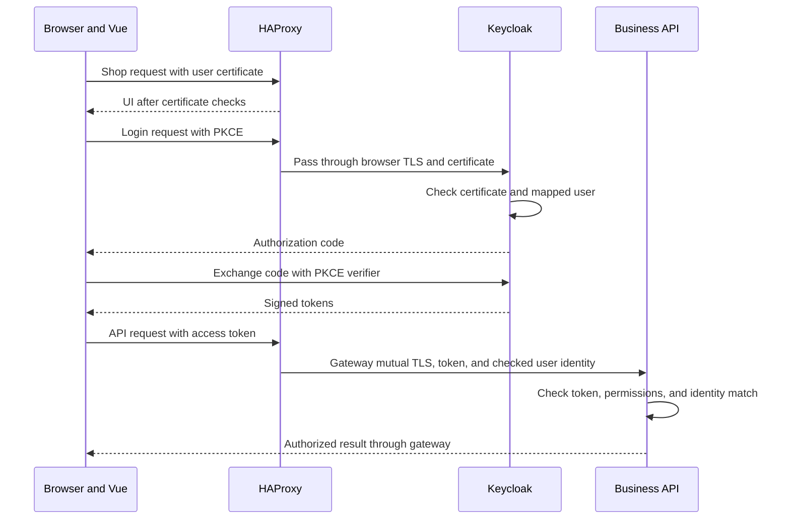
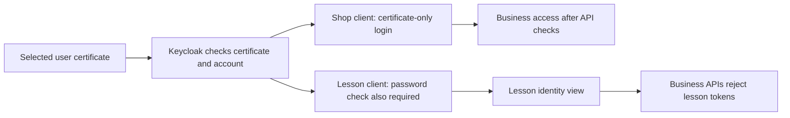

# Certificates and login

## Two checks have different purposes

Authentication checks identity. Authorization checks which actions that identity can do.
A valid certificate does not, by itself, permit an API action.
The APIs also require valid tokens and the correct permissions.

The lab certificate authority issues user certificates.
Keycloak checks the certificate holder and finds the matching user.
Keycloak signing keys sign tokens. These keys differ from user certificate keys.

## Shop login

The normal shop requires a user certificate. It has no password fallback.

1. The browser connects to the shop with its selected user certificate.
2. HAProxy checks certificate trust, validity, and revocation.
3. Vue starts a login request to Keycloak.
4. The authentication route passes TLS directly to Keycloak.
5. Keycloak checks the certificate and its protected user mapping.
6. Keycloak returns an authorization code.
7. Vue exchanges the code with PKCE and receives tokens.
8. Vue sends an access token with business API requests.

PKCE connects the code exchange to the browser that started the login.
The browser application has no embedded client secret.
Vue keeps access and refresh tokens in memory.

The code exchange also uses the authentication route. The diagram shortens that path for readability.

Each API checks the token signature, issuer, audience, and lifetime.
It also checks the required role and the match between token identity and certificate identity.
Private service requests have their own certificate and token requirements.

A trusted certificate can still belong to an unmapped or disabled user.
Such a certificate does not permit successful login or access to business records.

## Separate certificate and password lesson

The lesson uses a separate Keycloak client and callback.
It requires both the selected certificate and that account's password.
Keycloak collects the password on its own page. Vue does not collect it.
The lesson shows verified token identity. Its tokens do not permit business API access.

The two branches show separate client flows. Users do not choose a weaker check within one flow.

## Identity and storage

The operator assigns a stable certificate identity to each user.
Ordinary users cannot change that identity mapping.
Separate certificate authorities serve user, service, and server trust purposes.
Certificate generation and private keys stay in containers and Docker volumes.

Logout ends the session. It does not remove the installed certificate.
The same browser can authenticate again with that certificate.
Tests use a fresh browser context or profile when they change users.
Saved cookies must not bypass the certificate identity check.

See [authentication details](../authentication.md) for exact origins, clients, checks, and password setup.
See [lesson evidence](../completion/18-native-certificate-password-ci.md) for the 36-case native test matrix.
