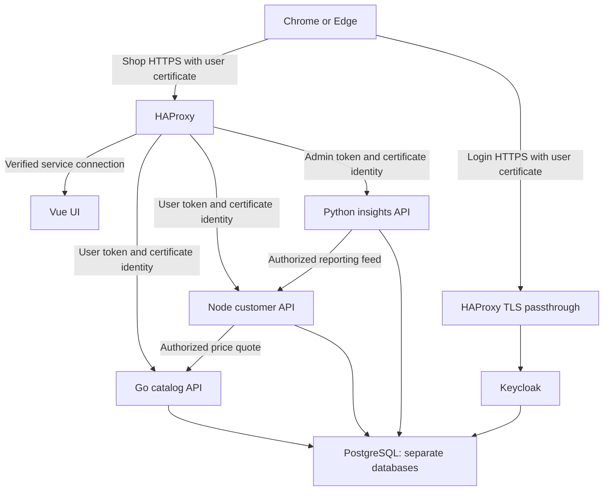

# Project and system

## Purpose

This project is a local teaching lab. It uses a simulated shop called Magic Shop.
It shows certificate login, API access checks, and tests with real or replaced dependencies.
It has no payment integration. It does not send real customer messages.

The browser uses a Vue application. Customers can view items, use a cart, and create simulated orders.
They can view their account and orders. Shopkeepers can change inventory.
Administrators can view customers, orders, sales, and regional reports.
The reporting screen includes a map and local follow-up notes.

The lab operator controls certificate issuance and user setup.
A shop user cannot issue an administrator certificate through the shop.

## System parts

| Part | Main task |
| --- | --- |
| Vue UI | Shows shop, account, inventory, and reporting screens. |
| HAProxy | Routes requests and checks certificates at the shop entry. |
| Keycloak | Checks login identity and issues signed tokens. |
| Go catalog API | Owns items, inventory, and price quotes. |
| Node customer API | Owns profiles, orders, checkout, and widget settings. |
| Python insights API | Builds regional reports and stores follow-up notes. |
| PostgreSQL | Stores records in separate databases with separate credentials. |
| PKI job | Creates the lab certificate authorities and certificates. |
| Test containers | Run API checks and real Chrome or Edge tests. |

PKI means public key infrastructure. It supplies the certificates and trust records used by the lab.



The diagram shows request paths. It does not show all certificate mounts or token checks.
Backend service connections use mutual TLS. Database connections use verified TLS.
The authentication connection passes through HAProxy without TLS termination there.
Thus, Keycloak receives the browser certificate directly.

## Data ownership

Each API owns its records. Another API uses an authorized interface to read those records.
For example, checkout gets a price quote from the catalog API.
The customer API records the order. The insights API reads the customer reporting feed.

The canonical OpenAPI files specify the three API interfaces.
They contain 23 business operations in total.
Tests check requests, response bodies, response headers, and documented status codes.

## Files to find

| Directory | Contents |
| --- | --- |
| `apps/` | The browser application. |
| `services/` | The three business APIs. |
| `contracts/openapi/` | Canonical API contracts. |
| `infra/` | Container, routing, certificate, and CI setup. |
| `testing/` | Shared models, test runners, and isolated test suites. |
| `spikes/mock-auth/` | Separate dependency-replacement examples. |
| `docs/completion/` | Commands, environments, observed results, and limits. |
| `artifacts/` | Local reports and recordings. Git does not track these files. |

## Start the lab

Run commands from the repository root. Docker and Docker Compose must be available.

1. Start the lab:

   ```sh
   ./lab up
   ```

2. Check the service state:

   ```sh
   ./lab status
   ```

3. Run one customer browser test:

   ```sh
   ./lab test --runner playwright --browser chrome --user customer-waterdeep
   ```

The wrappers run builds, certificate work, and tests in containers.
Private keys, secrets, and browser profiles stay in Docker volumes.
Do not install lab certificates into the host trust store to run these tests.

See the [teaching guide](../teaching-guide.md) for operator steps, troubleshooting, and reset.
See the [architecture](../architecture.md) for the full system design.
