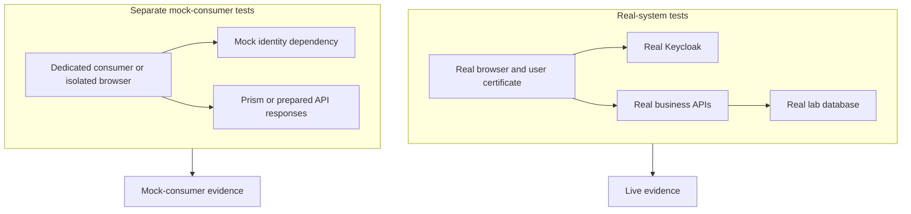
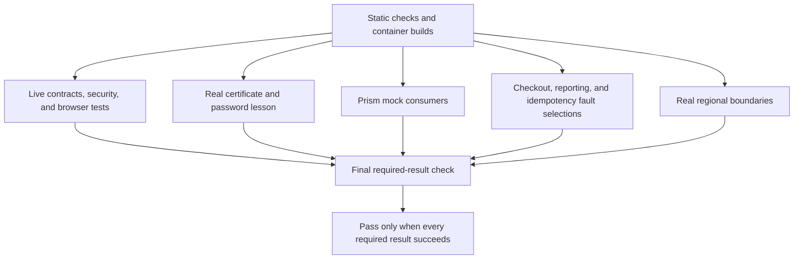

# Tests and evidence

## Select the question first

A test result supports the behavior that the test actually checked.
A mock result does not prove that real Keycloak or a real API works.
A browser recording shows the visible steps. Assertions check the required results.

| Test type | Question it answers | Important limit |
| --- | --- | --- |
| Live contract test | Does a real API follow its OpenAPI contract? | Only the checked operations and cases have evidence. |
| Live security test | Does the real system reject the tested unauthorized requests? | A pass does not prove every possible security property. |
| Real browser test | Does a selected user complete the checked journey? | Evidence applies to the selected browser, runner, and environment. |
| Standalone mock test | Does a dedicated consumer respond correctly to prepared dependency behavior? | It does not prove real login or provider behavior. |
| Browser mock test | Does the UI respond correctly to controlled authentication and API fixtures? | Synthetic authentication stays within the isolated mock test. |
| Dependency fault test | Does a real consumer respond correctly when one dependency fails? | It does not replace the normal live-provider gate. |

## Three dependency-replacement examples

FEATURE-01 uses a small JWT consumer and temporary signing keys.
JWT means JSON Web Token. The example checks valid, expired, wrong-audience, and altered-signature tokens.
It proves the example verifier's checks. It does not prove real Keycloak login or production API authorization.

FEATURE-02 uses a standalone OIDC mock and a dedicated token consumer.
OIDC means OpenID Connect. Discovery tells the consumer where the issuer's endpoints are.
JWKS supplies public keys for signature checks.
The example checks discovery, keys, tokens, failures, and a fresh successful request after a failure.
It does not prove real client credentials, certificate login, or the shop's PKCE flow.

FEATURE-03 uses Prism to replace a catalog dependency.
The dedicated consumer receives canonical success fixtures, structured errors, a delay, and recovery.
Existing Ajv tooling checks valid fixtures against the API schema.
An intentionally invalid fault fixture has a clear label and must fail that validation.
The example does not prove real catalog behavior or database effects.

Run these examples from the repository root:

```sh
./spikes/mock-auth/run.sh jwt
./spikes/mock-auth/run.sh oidc
./spikes/mock-auth/run.sh api
```

Each wrapper creates an isolated project and removes its test resources.
The network consumer verifies TLS. Signing keys and secrets stay in disposable storage or mock process memory.
See the [example guide](../../spikes/mock-auth/README.md) for exact checks and cleanup recovery.

## Browser tests with mock authentication

Browser tests can use a replacement for Keycloak within an isolated test system.
This project has separate browser consumers and an isolated Vue test setup.
Synthetic authentication does not reach real business APIs.
The tests do not change the shop's normal authentication code or Keycloak flows.



There is no connection from the mock test system to the real business APIs.
Fault suites use a third arrangement: a real consumer with one controlled dependency.
For example, Mokapi supplies scripted reporting pages to the real insights consumer.
The fault setup retains verified TLS and real authorization at the tested boundary.

See the [standalone browser guide](../../spikes/mock-auth/browser/README.md),
[Prism browser guide](../../testing/prism/README.md), and
[Mokapi reporting guide](../../testing/faults/reporting/README.md).

## Independent CI checks

CI keeps live, lesson, mock-consumer, fault, and regional results separate.
The fault selections cover checkout, reporting, and idempotency.
Idempotency checks that repeated checkout requests do not create duplicate effects.



The final check rejects missing, skipped, cancelled, or failed required jobs.
Each new suite also checks cleanup after a separate intentional failure.
A failed job can upload a failed report. Upload success does not make the test pass.

Run one isolated selection locally:

```sh
CI_EVIDENCE_ID=plain-guide-example ./testing/ci/run-isolated.sh consumer
CI_EVIDENCE_ID=plain-guide-example ./testing/ci/probe-failure.sh consumer
CI_EVIDENCE_ID=plain-guide-example ./testing/ci/cleanup-isolated.sh consumer
```

Use a fresh ID for another run. Select `checkout`, `reporting`, `idempotency`, or `regional` for other suites.
See the [CI guide](../../testing/ci/README.md) for Linux platform settings and cleanup details.

## Read results and recordings

Local reports are under `artifacts/`. Applicable browser suites produce local WebM recordings.
The certificate-password matrix has a separate opt-in recorder.
CI uploads allowlisted text reports. It does not upload videos, credentials, profiles, or network captures.

Check the test assertions with the recording. Check the environment and report source before you reuse a result.
The completion notes record exact commands, pinned versions, results, and limitations.

Native Linux push run `38115515064` and PR run `38115518115` passed all 13 expanded jobs.
Intentional-failure run `38115560267` failed the selected checkout job and final gate as required.
These are recorded results, not new runs made for this guide.
See [completion 26](../completion/26-independent-ci-evidence.md) for the full evidence.

The regional timestamp precision issue remains open.
The UI shows only the first 25 rows in the affected regional view.
Manual Linux viewer and operator checks remain unverified.
Standalone JWT and OIDC examples retain their recorded local evidence.
The project is not deployed, and the draft pull request is not merged.
