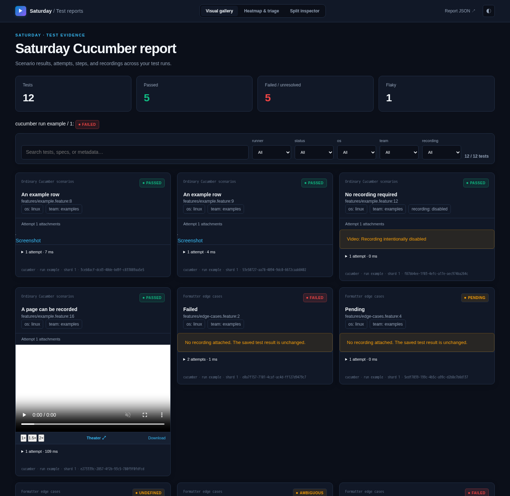
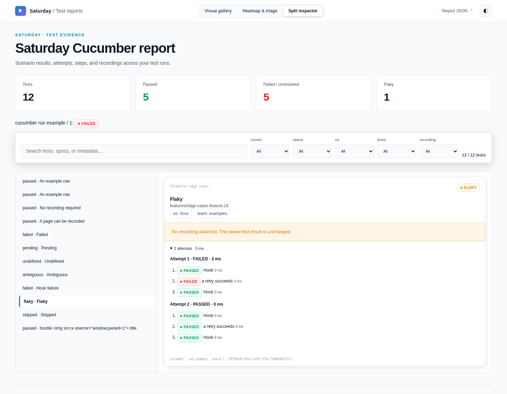

# Saturday Cucumber formatter

Saturday HTML reports for ordinary Cucumber.js projects. Features, scenario outline rows, steps, hooks, retries, attachments, and original statuses appear in the same gallery as Saturday’s Playwright reports. No Saturday framework is required.



The visual gallery keeps outline rows and scenario results distinct. The light-theme split inspector below shows both attempts and step results for a flaky Cucumber scenario.



Screenshots use the standalone verification examples, including deliberate failures and retries.

## Install and configure

Initial compatibility: Node **24.x**, ESM, `@cucumber/cucumber` **12.9.0**. This release uses that version’s supported `Formatter` API; it does not claim compatibility with later formatter-plugin APIs.

```sh
npm install --save-dev @orieken/saturday-cucumber-formatter @cucumber/cucumber@12.9.0
```

```js
// cucumber.mjs
export default {
  import: ['features/steps.mjs'],
  format: ['progress', '@orieken/saturday-cucumber-formatter:saturday-formatter.log'],
  formatOptions: {
    saturday: { outputDir: 'saturday-report', title: 'Acceptance tests' },
  },
};
```

Run `npx cucumber-js`, then open `saturday-report/index.html`. The formatter supports parallel workers and retries; rendering occurs after the coordinator has collected the run. Formatter errors propagate through Cucumber’s normal completion path.

## Optional video recording

Cucumber does not record browser video. Your hooks can supply a standard attachment; the formatter itself requires no Playwright dependency:

```js
import { Before, After } from '@cucumber/cucumber';
import { readFile } from 'node:fs/promises';
// Supply your own shared `browser`, e.g. from a BeforeAll hook.
Before(async function () {
  this.context = await browser.newContext({ recordVideo: { dir: 'test-results/videos' } });
  this.page = await this.context.newPage();
});
After(async function () {
  if (!this.context) return;
  const video = this.page.video();
  await this.context.close();
  if (video) await this.attach(await readFile(await video.path()), {
    mediaType: 'video/webm', fileName: 'Scenario recording',
  });
});
```

Closing the context finalizes the video before it is attached. Attach screenshots with `image/png`. No browser or video is required for ordinary scenarios. See `examples/basic` for complete browser lifecycle hooks and a parallel scenario-outline example.

## Metadata, merging, and output

`formatOptions.saturday` accepts `outputDir`, `title`, `runId`, `shard`, and a string-map `metadata`. Tags such as `@saturday:auth=oidc` and `@saturday:persona=admin` add scenario labels and override run labels. `@saturday:recording=disabled` explicitly marks intentionally disabled recording. Runner and result filters are reserved.

Set a shared `runId` and distinct `shard` values when merging separate Cucumber invocations. Parallel workers within one invocation already form one report. Use a distinct output directory per invocation, then merge `report.json` files with `@orieken/saturday-reporting`.

Passed, failed, skipped, pending, undefined, ambiguous, and unknown statuses are preserved. A scenario passing after failure is flaky; outline rows retain separate identities and source lines. Raw errors, stacks, stdout, and unsupported attachment contents are excluded. Titles, steps, labels, and media still contain test-supplied data: review before sharing.

Archive the entire output directory for portable playback. Only Saturday-owned output directories can be replaced on a later run.

For credential-sensitive suites, set `includeSteps: false` to omit runner step titles while retaining test results and attachments. Step titles can contain entered values; this option does not redact producer-supplied test names, labels, or media.

Cucumber selects one formatter per output destination. Give this silent formatter a distinct output file when using another stdout formatter; otherwise Cucumber can replace the earlier stdout formatter. The sink file is separate from the generated HTML report.
