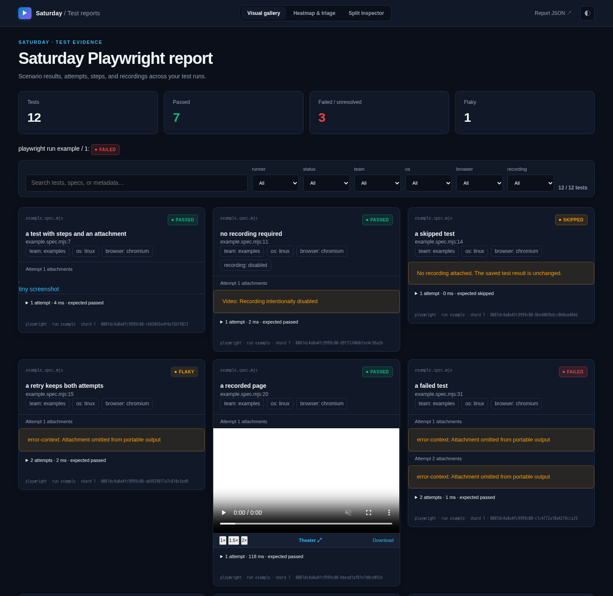
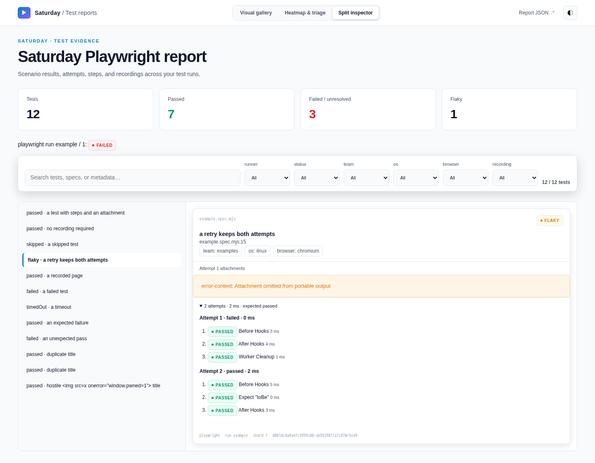

# Saturday Playwright reporter

Saturday HTML reports for ordinary Playwright Test projects. Includes a visual gallery, heatmap, split inspector, themes, filters, steps, attempts, screenshots, and video playback. No Saturday framework or Go dependency.



The visual gallery keeps each test and its attachments together. The light-theme split inspector below shows both attempts of a flaky Playwright test.



Screenshots use the standalone verification examples, including deliberate failures and retries.

## Install and configure

Compatibility: Node **24.x**, ESM, `@playwright/test` **1.65.1**.

```sh
npm install --save-dev @orieken/saturday-playwright-reporter @playwright/test@1.65.1
```

```js
// playwright.config.mjs
import { defineConfig } from '@playwright/test';
export default defineConfig({
  reporter: [
    ['list'],
    ['@orieken/saturday-playwright-reporter', {
      outputDir: 'saturday-report', title: 'My tests',
      metadata: { team: 'checkout' },
    }],
  ],
  use: { video: 'retain-on-failure', screenshot: 'only-on-failure' },
});
```

Run `npx playwright test`, then open `saturday-report/index.html`. Video is optional: every discovered test appears even without attachments. Built-in and third-party reporters can run alongside this reporter. A report-generation failure fails the run instead of silently leaving stale output.

## Optional metadata

`metadata` is a string map. Run-level labels can also come from `config.metadata.saturday`; project labels from `project.metadata.saturday`. Explicit reporter metadata overrides config labels; project and test labels override run labels. The adapter supplies OS, project, and browser labels automatically. `runner` and `status` are reserved display filters.

Use tags such as `@saturday:auth=oidc` or annotations such as `{ type: 'saturday', description: 'persona=admin' }`. To mark recording intentionally disabled, add `recording=disabled`; absence of a video alone does not prove it was disabled.

`runId` defaults to a UUID. For sharded reports set the same run ID and distinct `shard` values; the Playwright shard number is used by default. Give each invocation its own output directory, then use the core package’s `saturday-report merge` CLI.

## Results and artifacts

Attempts preserve Playwright statuses, including timeouts and interruptions. Expected failures count as successful expectations while retaining their actual failure status. Unexpected passes count as failures. Flaky tests remain distinct from consistently passing tests.

The reporter copies supported media attachments from the project root and configured project output directories. Add `artifactRoots` for other explicitly trusted locations. Raw error text, stack traces, stdout, arbitrary logs, and source archives are excluded. Test titles, steps, labels, and media remain your responsibility to review before sharing.

Move the entire output directory, including `media/` and `report.json`. Repeated runs replace only Saturday-owned output. Do not share an output directory between concurrent runs. The runnable example in `examples/basic` also demonstrates custom recording attachments and coexistence with Playwright JSON output.

For credential-sensitive suites, set `includeSteps: false` to omit runner step titles while retaining test results and attachments. Step titles can contain entered values; this option does not redact producer-supplied test names, labels, or media.
